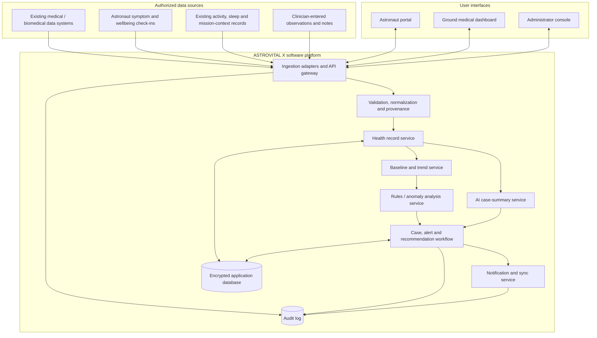
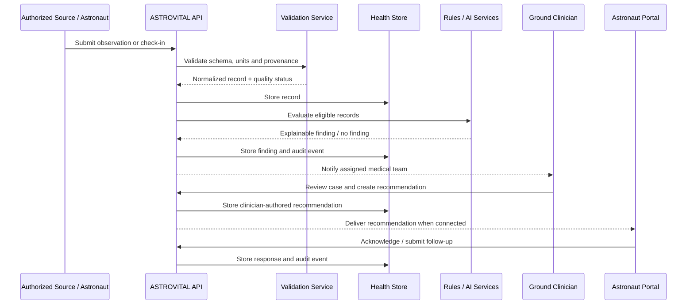
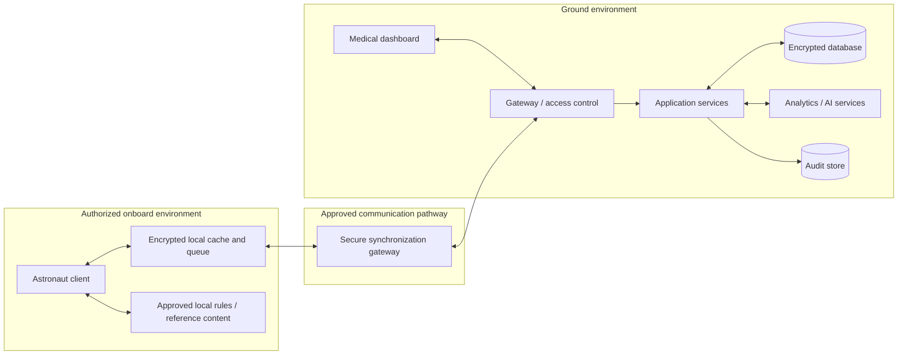
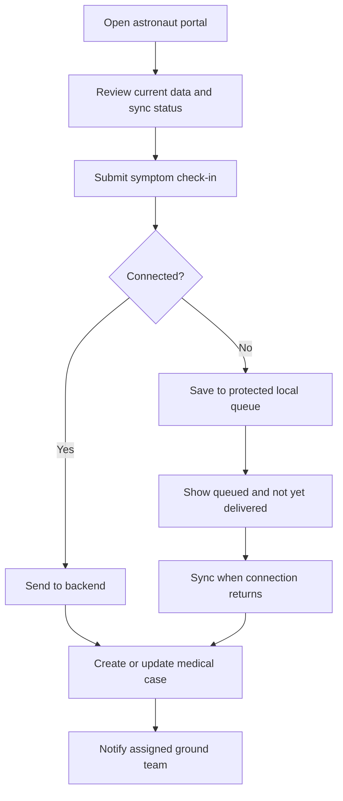
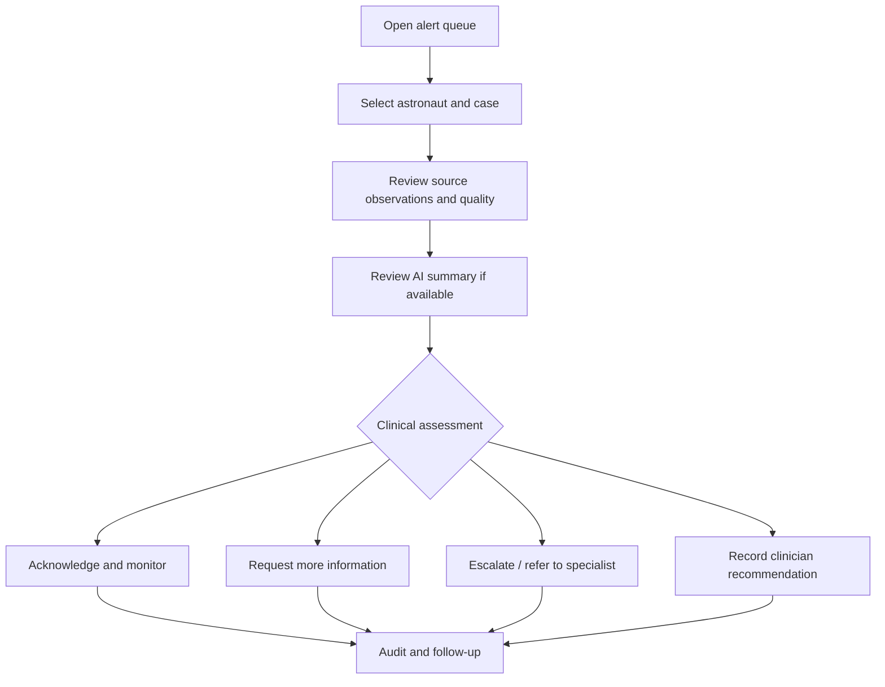
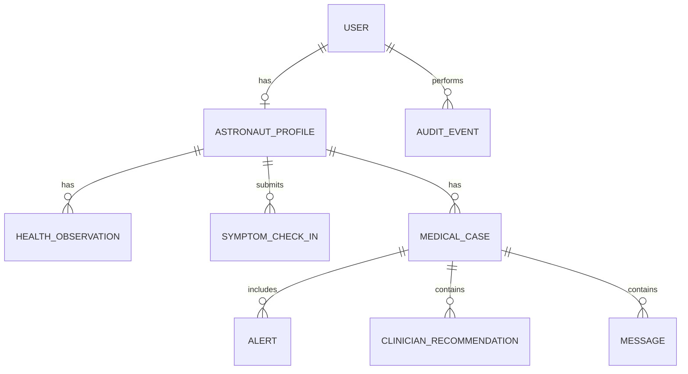

# ASTROVITAL X — Complete Project Documentation

Document set version 1.0 | Baseline date: 15 November 2026

This combined file contains the complete documentation pack. Individual Markdown files are available in the `docs/` directory in the ZIP archive.


---

<!-- Source file: README.md -->

# ASTROVITAL X — Project Documentation

**Project type:** Software-only astronaut health intelligence and medical collaboration platform  
**Document set version:** 1.0  
**Baseline date:** 15 November 2026  
**Project maturity:** Concept and hackathon-prototype planning

## Project in one paragraph

ASTROVITAL X is a proposed software platform that organizes health information already collected by authorized spacecraft medical systems, approved monitoring devices, and astronaut self-reports. It creates a longitudinal astronaut health profile, checks data quality, highlights unusual trends for clinical review, and gives authorized ground medical professionals a workspace to review cases and send recommendations. The platform is designed with two operating conditions in mind: connected operations, when data exchange and consultation are available, and communication-constrained operations, when onboard software must continue local recordkeeping and provide only pre-approved, non-diagnostic support.

> **Scope boundary:** ASTROVITAL X does not design, manufacture, or directly operate medical sensors, cameras, wearables, or other hardware. It does not claim to measure vital signs independently. It consumes data from existing authorized systems or clearly labelled synthetic data in the prototype.

## Documentation map

| File | Purpose |
|---|---|
| [`docs/01_PRD.md`](docs/01_PRD.md) | Product requirements, users, scope, user stories and acceptance criteria |
| [`docs/02_ARCHITECTURE.md`](docs/02_ARCHITECTURE.md) | Logical architecture, components, data flows, deployment and resilience |
| [`docs/03_DESIGN_UX.md`](docs/03_DESIGN_UX.md) | UX principles, roles, screens, workflows and interaction design |
| [`docs/04_PRODUCT_AND_ENGINEERING_RULES.md`](docs/04_PRODUCT_AND_ENGINEERING_RULES.md) | Clinical safety, AI, security, privacy, data and engineering rules |
| [`docs/05_TASKS_BACKLOG.md`](docs/05_TASKS_BACKLOG.md) | Phased implementation plan and actionable task backlog |
| [`docs/06_PROGRESS.md`](docs/06_PROGRESS.md) | Honest project status, milestones, blockers and progress log |
| [`docs/07_DATA_MODEL.md`](docs/07_DATA_MODEL.md) | Core entities, fields, provenance and sample synthetic records |
| [`docs/08_API_SPEC.md`](docs/08_API_SPEC.md) | Prototype API routes, payload examples and error conventions |
| [`docs/09_TEST_PLAN.md`](docs/09_TEST_PLAN.md) | Functional, safety, security, AI and offline-mode test plan |
| [`docs/10_DECISIONS_AND_ASSUMPTIONS.md`](docs/10_DECISIONS_AND_ASSUMPTIONS.md) | Architecture decisions, assumptions, open questions and risks |
| [`docs/11_HACKATHON_DEMO.md`](docs/11_HACKATHON_DEMO.md) | Suggested demo story, sample data and judge-facing explanation |

## Recommended reading order

1. Read the PRD to understand what is being built and what is deliberately excluded.
2. Read the architecture and data model before implementation.
3. Agree the product and engineering rules before building AI or clinical workflows.
4. Use the task backlog to divide work between team members.
5. Update the progress file whenever a task changes state.
6. Use the API and test plans to keep frontend, backend and AI work aligned.

## Suggested repository layout

```text
astrovital-x/
├── README.md
├── docs/
│   ├── 01_PRD.md
│   ├── 02_ARCHITECTURE.md
│   ├── 03_DESIGN_UX.md
│   ├── 04_PRODUCT_AND_ENGINEERING_RULES.md
│   ├── 05_TASKS_BACKLOG.md
│   ├── 06_PROGRESS.md
│   ├── 07_DATA_MODEL.md
│   ├── 08_API_SPEC.md
│   ├── 09_TEST_PLAN.md
│   ├── 10_DECISIONS_AND_ASSUMPTIONS.md
│   └── 11_HACKATHON_DEMO.md
└── src/                  # Application code, to be created by the team
```

## Prototype truth statement

For the hackathon, use synthetic astronaut profiles and synthetic health observations unless the team has a formally authorized, privacy-safe dataset. Label all synthetic values clearly in the interface and demo. A successful prototype demonstrates software workflows, data handling, trend analysis, case review and messaging; it does **not** prove medical accuracy or flight readiness.

## Versioning guidance

- Update the document-set version when scope, requirements, architecture or safety rules materially change.
- Add dated entries to `docs/06_PROGRESS.md` rather than rewriting history.
- Record consequential design choices in `docs/10_DECISIONS_AND_ASSUMPTIONS.md`.
- Keep requirements IDs stable once referenced by tasks or tests.


---

<!-- Source file: docs/01_PRD.md -->

# 01 — Product Requirements Document (PRD)

**Product:** ASTROVITAL X  
**Version:** 1.0  
**Status:** Proposed baseline  
**Date:** 15 November 2026

## 1. Executive summary

ASTROVITAL X is a software-only astronaut health intelligence and Earth-to-space medical collaboration platform. It organizes health information from authorized existing sources, creates a longitudinal health profile for each astronaut, detects data-quality issues and potentially concerning patterns, and supports a human-led medical review workflow between astronauts and ground medical professionals.

The product does not build or operate sensors. It does not independently measure heart rate, ECG, oxygen saturation, blood pressure, temperature, hydration, sleep, or mental health. Those values must arrive from an authorized existing data source or be entered by an astronaut or clinician. In the hackathon prototype, synthetic data will be used and visibly labelled.

ASTROVITAL X is a clinical decision-support concept, not an autonomous doctor. AI can organize information and flag patterns for review; qualified medical professionals remain responsible for diagnosis and treatment decisions.

## 2. Problem statement

Astronaut health information may be produced by different monitoring systems, medical records, activity logs and astronaut-reported assessments. Ground medical teams need a coherent way to review this information, understand changes over time, follow up on concerns and communicate guidance. During communication interruptions or long-delay missions, information exchange with Earth may not be immediate.

The project explores whether a unified software workflow can make available astronaut health information more organized, interpretable and actionable while preserving clinician oversight and supporting constrained-connectivity operations.

## 3. Product vision

**Vision:** Help astronauts and authorized medical teams maintain a shared, trustworthy view of astronaut health by connecting existing data, personalized trend analysis and human medical expertise.

**One-line pitch:** ASTROVITAL X connects astronaut health records, onboard AI-assisted analysis and ground medical experts in one software platform.

## 4. Goals

### 4.1 Primary goals

- G1: Provide a unified profile containing available astronaut health records and observations.
- G2: Display the source, timestamp, unit and quality status of every health observation.
- G3: Compare observations with an astronaut's own baseline where enough valid history exists.
- G4: Identify potentially unusual patterns for human review without presenting them as diagnoses.
- G5: Allow authorized ground medical professionals to review cases and record recommendations.
- G6: Allow astronauts to submit symptoms, check-ins, consultation requests and follow-up responses.
- G7: Preserve local access to previously synchronized information during connectivity loss and synchronize queued records later.
- G8: Provide a realistic hackathon prototype using synthetic data without requiring new medical hardware.

### 4.2 Secondary goals

- Support multiple specialist roles and case assignment.
- Summarize health history and consultation events for faster review.
- Provide audit trails for access, edits, alerts and clinical recommendations.
- Make future integration with approved spacecraft data systems possible through documented interfaces.

## 5. Non-goals

The following are explicitly outside the project's current scope:

- Designing, building, procuring or certifying sensors, wearables, cameras, scanners or medical devices.
- Directly measuring physiological values from a laptop, phone or ordinary camera.
- Replacing NASA flight surgeons, physicians, psychologists or other clinical professionals.
- Automatically diagnosing diseases or prescribing medication.
- Automatically changing treatment, spacecraft operations or emergency procedures.
- Claiming that an unvalidated model predicts heart attacks, stroke, dehydration or other specific medical events.
- Claiming NASA endorsement, NASA deployment, flight certification or access to NASA operational systems.
- Assuming that a live video call to Earth is always possible during deep-space missions.
- Using real astronaut medical records in a public demo without formal authorization.

## 6. Target users and roles

| User role | Needs | Main capabilities |
|---|---|---|
| Astronaut / crew member | Understand own available health information, report symptoms, request help and receive instructions | View own profile, submit check-ins, create consultation request, acknowledge guidance, submit follow-up |
| Flight surgeon / primary medical officer | Review crew health, triage incoming concerns and coordinate follow-up | View assigned crew, review records, inspect trends, acknowledge alerts, create recommendations and assign follow-up |
| Specialist clinician | Review a referred case in their specialty | Access only assigned/referral case data, add specialist opinion and questions |
| Biomedical / mission support specialist | Review data quality and technical telemetry context | Inspect source metadata and ingestion status; no clinical decision authority unless separately assigned |
| System administrator | Manage accounts, roles, configuration and audit access | Manage users/roles, data-source configuration, system health and retention settings |
| Evaluator / demo user | Explore a simulated end-to-end workflow | Use seeded synthetic demo accounts and data only |

## 7. Core use cases

### UC-01: View astronaut health profile

1. An authorized user opens an astronaut profile.
2. The system displays available observations, timestamps, source, units and quality markers.
3. The system shows historical trends only where enough data exists.
4. Missing or stale data is clearly identified.

**Acceptance:** A user never sees a synthetic observation presented as a real measurement; each displayed observation has provenance and timestamp metadata.

### UC-02: Submit a symptom check-in

1. The astronaut opens the check-in form.
2. The astronaut selects symptoms, onset, severity and free-text context.
3. The astronaut submits the check-in.
4. The system stores it and creates a case or adds it to an existing open case.
5. The assigned medical team receives an in-app notification when connected.

**Acceptance:** Submission is timestamped, attributed to the submitting user and visible to authorized clinical roles.

### UC-03: Generate an AI-assisted review summary

1. A case contains health observations and a symptom report.
2. The AI service receives only the data permitted for that task.
3. The service produces a structured summary of facts, trends, missing data and possible reasons for review.
4. The system labels the summary as AI-generated and links each factual item to its source record.
5. A clinician reviews, edits or rejects the summary.

**Acceptance:** AI output is not saved as a clinician-authored finding, and unsupported inferences are not presented as facts.

### UC-04: Create and manage a medical alert

1. A rules engine or reviewed model flags a potentially unusual pattern.
2. The system creates an alert with evidence, data-quality status and reason.
3. The assigned medical team acknowledges, dismisses as non-actionable, or escalates the alert.
4. The system records the decision and user.

**Acceptance:** An alert always includes the input observations or rule that triggered it; no alert automatically issues treatment instructions.

### UC-05: Ground clinician reviews case and sends recommendation

1. The clinician opens an assigned case.
2. The clinician reviews health observations, symptom report and AI summary.
3. The clinician records a recommendation using a structured form.
4. The recommendation is marked as clinician-authored, time-stamped and versioned.
5. The astronaut receives it when communication is available.
6. The astronaut acknowledges and can submit requested follow-up information.

**Acceptance:** The clinician's identity, role, timestamp and recommendation history are retained in the audit trail.

### UC-06: Operate during communication interruption

1. The client detects that the remote service is unavailable.
2. It displays the last synchronization time and offline state.
3. Permitted new check-ins and messages are stored in a protected local queue.
4. The interface clearly indicates that a message has not yet reached the ground team.
5. When the connection returns, the client synchronizes queued items and records delivery status.

**Acceptance:** The UI never implies that a queued medical message has been received or read by a clinician before server acknowledgement.

## 8. Functional requirements

Priority definitions: **P0** = required for hackathon MVP; **P1** = important next increment; **P2** = future capability.

| ID | Requirement | Priority |
|---|---|---|
| FR-001 | Users must authenticate before viewing protected astronaut information. | P0 |
| FR-002 | The system must enforce role-based access to astronaut profiles and clinical actions. | P0 |
| FR-003 | The system must display astronaut profile details and available health observations. | P0 |
| FR-004 | Every observation must include source, timestamp, unit, provenance and data-quality status. | P0 |
| FR-005 | The system must support clearly labelled synthetic demo records. | P0 |
| FR-006 | Astronauts must be able to submit symptom check-ins. | P0 |
| FR-007 | Authorized clinicians must be able to view assigned cases. | P0 |
| FR-008 | The system must generate a basic rules-based alert from seeded demo data. | P0 |
| FR-009 | Clinicians must be able to acknowledge, dismiss or escalate an alert with a reason. | P0 |
| FR-010 | Clinicians must be able to create a recommendation and request follow-up. | P0 |
| FR-011 | Astronauts must be able to view and acknowledge clinician recommendations. | P0 |
| FR-012 | The system must maintain an audit record of protected access and clinical actions. | P0 |
| FR-013 | The system must show data freshness and synchronization status. | P0 |
| FR-014 | The system must support a doctor dashboard and astronaut portal. | P0 |
| FR-015 | AI-generated content must be visibly labelled and distinguishable from clinician-authored content. | P0 |
| FR-016 | The system must support historical trend visualization when data is sufficient. | P1 |
| FR-017 | The system should maintain a personal baseline with confidence and minimum-data checks. | P1 |
| FR-018 | The system should include anomaly detection with explainable evidence. | P1 |
| FR-019 | The system should support specialist referrals and case assignment. | P1 |
| FR-020 | The system should queue permitted records during disconnection and sync after reconnection. | P1 |
| FR-021 | The system may generate a source-linked AI case summary. | P1 |
| FR-022 | The system may support secure asynchronous message threads. | P1 |
| FR-023 | The system may integrate with authorized external health-data interfaces. | P2 |
| FR-024 | The system may support approved medical knowledge retrieval with citations. | P2 |
| FR-025 | The system may support validated research models for mission-specific risk estimation. | P2 |

## 9. Non-functional requirements

| ID | Requirement | Target / guidance |
|---|---|---|
| NFR-001 | Security | TLS in transit, encryption at rest, secrets outside source code, least-privilege access |
| NFR-002 | Privacy | Collect minimum necessary data; use synthetic records in the public demo |
| NFR-003 | Auditability | Record user, action, object, timestamp and outcome for sensitive actions |
| NFR-004 | Reliability | Core read/write workflows must return clear success or failure states |
| NFR-005 | Offline resilience | Preserve queued, permitted user submissions and show delivery state |
| NFR-006 | Explainability | Alerts must show why they were raised and which records were used |
| NFR-007 | Accessibility | Keyboard-accessible controls, readable contrast, labels and non-color-only status cues |
| NFR-008 | Interoperability | Use documented, versioned APIs and normalized units |
| NFR-009 | Maintainability | Separate frontend, backend, data, AI and notification modules |
| NFR-010 | Performance | Prototype screens should remain responsive on ordinary development laptops and demo data volumes |
| NFR-011 | Data integrity | Validate ranges, units, timestamps, duplicates and missing values before analysis |
| NFR-012 | Clinical safety | No autonomous diagnosis, prescribing or treatment execution |

## 10. User stories

- US-01: As an astronaut, I want to see my latest available health status so I can understand what information is on record.
- US-02: As an astronaut, I want to report symptoms so that the medical team can review my concern.
- US-03: As a flight surgeon, I want to see my assigned crew's health timelines so I can review changes over time.
- US-04: As a flight surgeon, I want to see why an alert was generated so I can assess its relevance.
- US-05: As a clinician, I want to send a recommendation and follow-up request so the astronaut can act and report back.
- US-06: As a specialist, I want access to a referred case without unrestricted access to unrelated crew records.
- US-07: As a user, I want to know whether the system is offline and whether my message was delivered.
- US-08: As an administrator, I want to review audit events so that access and clinical actions are traceable.

## 11. Hackathon MVP scope

The recommended MVP demonstrates a complete software workflow with synthetic data:

1. Login with demo roles: astronaut, flight surgeon and administrator.
2. Astronaut profile with synthetic observations and clear synthetic-data labels.
3. Health timeline with at least three available indicators.
4. Symptom check-in form.
5. Simple explainable rule-based alert or anomaly flag.
6. Doctor dashboard with case list and detail view.
7. Doctor-authored recommendation and follow-up request.
8. Astronaut view and acknowledgement of recommendation.
9. Audit log and data freshness indicator.
10. Demonstration of offline/queued message state, even if simulated in the prototype.

## 12. MVP acceptance criteria

The MVP is accepted when all of the following can be demonstrated end to end:

- A demo astronaut can sign in and view only their own profile.
- A demo astronaut can submit a symptom check-in.
- A flight surgeon can sign in and see the case for an assigned astronaut.
- The system can show synthetic observations with units, timestamps, source and labels.
- At least one transparent rule can create an alert from a seeded scenario.
- The clinician can acknowledge the alert and record a recommendation.
- The astronaut can view and acknowledge the recommendation.
- The app records key actions in an audit log.
- The interface distinguishes AI-generated, clinician-authored, imported and synthetic information.
- A simulated disconnected state shows that an unsent item is queued, not delivered.

## 13. Success metrics for the prototype

These measure prototype completeness, not clinical performance:

- 100% of demo observations show a source, timestamp and synthetic/real-data status.
- 100% of clinician recommendations show author and timestamp.
- All protected views require authentication in the demo environment.
- The core astronaut-to-clinician workflow completes without manual database edits.
- The alert detail page explains the triggering rule and linked observations.
- Offline queue state is visibly distinguished from server-delivered state.

## 14. Risks and mitigations

| Risk | Impact | Mitigation |
|---|---|---|
| No access to real spacecraft medical data | Cannot demonstrate a live operational integration | Use realistic synthetic data; define adapter interfaces; never imply live NASA access |
| Clinical overclaiming | Safety and credibility risk | Use decision-support language; require clinician review; validate any medical model before use |
| Inconsistent units or timestamps | Incorrect trend analysis | Normalize units; store source units; validate timestamps and provenance |
| False alerts | Alert fatigue | Start with transparent demonstration rules; show evidence and confidence; allow clinician disposition |
| Communication delay | Ground response may not be immediate | Queue data; show delivery status; maintain approved onboard guidance |
| Privacy exposure | Sensitive medical information could be disclosed | Minimize data, enforce roles, encrypt, audit and use synthetic demo data |
| AI hallucination | Misleading summary or guidance | Restrict AI to source-grounded summaries; cite records; prohibit autonomous treatment advice |

## 15. Dependencies and assumptions

- The prototype has no direct connection to NASA or any operational spacecraft system.
- Real data access would require authorization, interface agreements, security review and clinical governance.
- Health observations are supplied by existing authorized systems or human entry; ASTROVITAL X is not a measurement device.
- Synthetic data will be used for public demonstrations.
- Medical thresholds and clinical workflows must be defined or approved by qualified spaceflight medical professionals before operational use.
- Connectivity and response times vary by mission distance, network availability and operational constraints.


---

<!-- Source file: docs/02_ARCHITECTURE.md -->

# 02 — System Architecture

**Version:** 1.0  
**Status:** Proposed logical architecture

## 1. Architecture principles

1. **Software-only scope:** ASTROVITAL X consumes available data; it does not create or control medical sensing hardware.
2. **Human clinical authority:** AI may summarize, classify data quality and flag patterns; clinicians make clinical decisions.
3. **Data provenance first:** Each observation carries source, unit, timestamp, collection context and quality metadata.
4. **Offline-aware:** The application distinguishes local, queued, synchronized, delivered and acknowledged states.
5. **Least privilege:** Astronauts see their own data; clinicians see assigned cases; specialists see referrals; administrators manage the platform.
6. **Modular integration:** External data sources connect through adapters instead of being embedded in business logic.
7. **Explainable alerts:** Every alert links to the records and rules that triggered it.
8. **Synthetic-first prototype:** All demo data is labelled synthetic. Operational integration is a future, authorized activity.

## 2. Logical system overview



## 3. Main components

### 3.1 Client applications

**Astronaut portal**
- Displays own health profile and available observations.
- Shows freshness and source labels.
- Captures symptom check-ins and wellbeing questionnaires.
- Displays clinician recommendations and requests for follow-up.
- Shows message delivery state and last successful synchronization.

**Ground medical dashboard**
- Lists assigned astronauts and open cases.
- Shows observations, trend plots, symptom reports and AI-generated summaries.
- Provides alert disposition, case assignment and recommendation workflows.
- Distinguishes AI-generated content from clinician-authored content.

**Administrator console**
- Manages demo accounts, role assignment and data-source configuration.
- Displays system health, ingestion errors and audit events.
- Does not provide clinical decision tools by default.

### 3.2 API gateway / backend

Responsibilities:
- Authenticate requests and resolve user identity.
- Enforce role-based access and astronaut assignment rules.
- Validate request schemas and units.
- Route requests to domain services.
- Apply rate limits and request-size limits.
- Create audit events for sensitive actions.

### 3.3 Data ingestion adapters

Each external data source should have its own adapter. An adapter maps the source-specific format into the normalized ASTROVITAL X observation schema.

Adapter requirements:
- Authenticate to the upstream system using an approved mechanism.
- Preserve upstream source identifier and record identifier.
- Preserve the original value and unit where appropriate.
- Convert to a canonical unit only when the conversion is known and tested.
- Record ingestion time separately from observation time.
- Reject or quarantine malformed records rather than silently correcting them.
- Support idempotent ingestion to avoid duplicate observations.

For the hackathon, implement a `synthetic-demo` adapter or seeded fixture loader. Do not create a fake NASA API integration.

### 3.4 Validation and normalization service

Checks:
- Required fields and types.
- Supported measurement type.
- Unit compatibility.
- Timestamp format and timezone handling.
- Plausibility bounds used only for data-quality screening, not diagnosis.
- Duplicate source records.
- Missing, stale or conflicting data.

Output: normalized observation plus a data-quality status such as `valid`, `missing_metadata`, `out_of_expected_range`, `stale`, `conflicting` or `rejected`.

### 3.5 Health record service

Stores astronaut profiles, observations, symptom check-ins, consultations, recommendations and follow-up responses. It provides authorized query and history endpoints.

### 3.6 Baseline and trend service

Creates personal reference summaries only when enough suitable observations exist. A baseline should include its date range, sample count, method, version and confidence/quality state. It must not silently treat population averages as an individual's normal value.

### 3.7 Rules and anomaly analysis service

MVP: transparent rules over seeded synthetic data.  
Next stage: validated statistical or machine-learning anomaly detection.

Every rule/model result should include:
- Result identifier and version.
- Relevant input observation identifiers.
- Trigger explanation.
- Time window.
- Missing-data and quality caveats.
- Severity or review priority, not a diagnosis.

### 3.8 AI case-summary service

Optional service that produces structured summaries from authorized records. It must not invent missing measurements, diagnoses, treatment plans or medical thresholds. Each factual statement should link to source record IDs. If the source evidence is insufficient, the output must say so.

### 3.9 Case and recommendation workflow

Manages:
- Case creation and assignment.
- Alert acknowledgement, disposition and escalation.
- Clinician review notes.
- Recommendations and follow-up requests.
- Astronaut acknowledgement and response.
- Case closure or continued monitoring.

### 3.10 Notification and synchronization service

Supports in-app alerts and queued messages. The system maintains distinct delivery states:

`draft → queued_local → submitted → delivered_to_service → viewed_by_recipient → acknowledged`

A local queue item must never be displayed as delivered before the server confirms receipt. A delivered message is not necessarily read or acted upon.

## 4. Data flow



## 5. Connected and communication-constrained modes

### Connected mode
- Synchronize new observations and check-ins.
- Notify assigned ground medical team.
- Support asynchronous consultation and, where mission systems permit, a separate approved voice/video service.
- Track sent, delivered, viewed and acknowledged states.

### Communication-constrained mode
- Keep local access to the latest synchronized profile and approved reference material.
- Allow permitted entries to be saved to an encrypted local queue.
- Run only approved local rules and non-diagnostic decision support.
- Display last synchronization time and clearly state that ground staff may not have received the new item.
- Do not promise live doctor response when the link is unavailable or delayed.

### Reconnection
- Retry queued records with idempotency keys.
- Resolve duplicate submissions safely.
- Preserve original event time and actual server receipt time.
- Surface conflicts for review rather than overwriting silently.

## 6. Recommended prototype technology layout

| Layer | Suggested implementation |
|---|---|
| Astronaut and doctor UI | React or Next.js |
| API | Python FastAPI |
| Authentication | Managed OIDC provider or secure demo auth; do not roll custom production auth |
| Database | PostgreSQL; SQLite acceptable for a very small local demo |
| Background jobs | Celery/RQ or a simple background worker for prototype |
| Realtime updates | WebSocket or Server-Sent Events |
| AI/analytics | Python, pandas, NumPy, scikit-learn |
| LLM summaries | Optional, constrained retrieval and source-linked output |
| Local/offline queue | IndexedDB in browser or encrypted local store in approved client |
| Deployment | Docker Compose for demo; production deployment requires security review |

## 7. Deployment view



This is a logical target model, not a claim that ASTROVITAL X is currently approved for spacecraft deployment. Real deployment would require the relevant mission architecture, cybersecurity, safety and medical approvals.

## 8. Security boundaries

- Astronaut client: user-scoped access to own records.
- Clinician client: case assignment and specialty-limited access.
- Admin console: account and configuration access; no implicit clinical authority.
- Integration adapter: narrowly scoped credentials for its approved upstream source.
- AI service: receives only the minimum records needed for a specific analysis.
- Audit store: append-oriented; ordinary users cannot modify audit history.

## 9. Scalability and future integrations

Potential future integrations should be implemented through versioned adapters and only after authorization. Candidate data categories include biomedical telemetry exports, medical record systems, mission activity logs, sleep records and astronaut self-assessments. Do not hard-code vendor or agency endpoints before an actual interface agreement exists.

## 10. Architecture decisions to preserve

- Store canonical units and original source unit/value where feasible.
- Separate observation time from ingestion time.
- Keep AI findings distinct from observations and clinician notes.
- Version rules and models.
- Make data quality visible to users.
- Store audit events for access and clinical workflow actions.
- Never equate alert severity with a diagnosis.


---

<!-- Source file: docs/03_DESIGN_UX.md -->

# 03 — Product Design and UX Specification

**Version:** 1.0  
**Status:** Proposed design baseline

## 1. Design objectives

The interface should make astronaut health information easy to review without implying more certainty than the data supports. The product has two main experiences—astronaut and ground medical expert—plus an administrative experience.

Design priorities:
- Clarity over visual complexity.
- Clear distinction between measured/imported data, self-reported data, synthetic demo data, AI-generated findings and clinician-authored decisions.
- Clear data freshness and synchronization state.
- Fast access to critical case context without hiding provenance.
- Accessible color contrast, keyboard navigation and text labels.
- Calm, professional medical operations aesthetic; avoid game-like or alarmist visuals.

## 2. Information architecture

```text
ASTROVITAL X
├── Astronaut Portal
│   ├── Overview
│   ├── My Health Timeline
│   ├── Symptom Check-in
│   ├── Medical Cases
│   ├── Doctor Recommendations
│   └── Sync / Messages
├── Medical Expert Dashboard
│   ├── Mission Overview
│   ├── Assigned Crew
│   ├── Alert Queue
│   ├── Astronaut Profile
│   ├── Health Timeline
│   ├── Case Review
│   ├── Specialist Referral
│   └── Recommendations / Follow-up
└── Administration
    ├── Users and Roles
    ├── Data Sources
    ├── System Status
    └── Audit Log
```

## 3. Role-based navigation

| Navigation item | Astronaut | Flight surgeon | Specialist | Admin |
|---|---:|---:|---:|---:|
| Own profile | Yes | If assigned/authorized | If referred/authorized | Support access only when authorized |
| Crew overview | No | Assigned crew | Referral scope | No clinical access by default |
| Submit symptoms | Yes | On behalf only if authorized | No, unless workflow requires | No |
| Alert queue | Own alert status | Assigned cases | Referred cases | Technical status only |
| Clinical recommendation | View/acknowledge | Create/revise | Create specialist opinion | No |
| User management | No | No | No | Yes |
| Audit log | Own relevant activity where policy permits | Clinical activity in permitted scope | Referral activity | Administrative/security events |

## 4. Screen specifications

### 4.1 Astronaut overview

**Purpose:** Give the astronaut a clear summary of available information and outstanding actions.

Elements:
- Welcome and mission/crew identifier (demo values only).
- Overall data status: current, partially current or stale.
- Last synchronization timestamp.
- Latest available health observations with units and timestamps.
- Open follow-up requests.
- Current medical recommendations.
- Symptom check-in action.
- Clear banner if data is synthetic or simulated.

Do not show a single green “healthy” badge based on incomplete data. Prefer “No open alerts in this view” or “Data incomplete—medical review may be needed.”

### 4.2 Astronaut symptom check-in

Fields:
- Symptom category (select multiple where appropriate).
- Onset date/time.
- Severity chosen by the astronaut using clear anchored labels.
- Whether symptoms are worsening, improving or unchanged.
- Optional free-text description.
- Optional structured wellbeing questions.
- Submit button and confirmation state.

The form must explain that submission does not guarantee immediate medical review, especially in communication-constrained mode. If an actual emergency exists, the astronaut must follow mission-approved emergency procedures; the software is not an emergency service.

### 4.3 Medical expert mission overview

Elements:
- Assigned astronaut roster.
- Open cases by review status.
- New and unacknowledged alerts.
- Data freshness and source connectivity indicators.
- Recently received check-ins.
- Queue filters: priority, astronaut, case status, time range.

Avoid ranking astronauts with a simplistic single “health score.” Use case-oriented signals and evidence.

### 4.4 Astronaut health profile

Sections:
- Profile and mission context.
- Current available observations.
- Historical trend charts.
- Symptom and wellbeing check-ins.
- Existing medical case history.
- Data sources and quality warnings.
- Personal baseline summary, if sufficient data exists.
- AI findings and clinician notes in separate panels.

Each chart should display the measure, unit, source, time window and missing-data gaps.

### 4.5 Alert detail and case review

Elements:
- Alert name and review priority.
- Clear statement: “This is a software-generated flag for review, not a diagnosis.”
- Trigger rule/model and version.
- Linked observation records.
- Data quality and freshness notes.
- Relevant baseline and time window.
- AI summary (if enabled) with source links.
- Clinician review notes.
- Actions: acknowledge, dismiss with reason, escalate, request more information, assign specialist.

### 4.6 Clinician recommendation composer

Fields:
- Recommendation category.
- Instruction text.
- Requested astronaut follow-up.
- Due/target time where appropriate.
- Priority.
- Optional approved reference/protocol link.
- Confirm authorship and submit.

The UI must make clear that the recommendation is authored by the logged-in clinician. No AI-generated treatment instructions should be sent without clinician review and explicit approval.

### 4.7 Consultation and messaging

Elements:
- Case-linked asynchronous message thread.
- Author, timestamp and delivery state.
- Attachments only if allowed by the security policy and configured limits.
- Separate link to an approved external voice/video service if available.

Do not implement an unverified promise of real-time telemedicine. Show when a message is queued, delivered, viewed or acknowledged.

### 4.8 Offline and synchronization status

Use persistent status indicators:
- **Connected:** server reachable; last sync time shown.
- **Syncing:** upload/download in progress.
- **Queued locally:** saved on device but not yet delivered to the ground service.
- **Partially synchronized:** some records remain pending.
- **Stale data:** no recent update from a source.
- **Conflict requires review:** duplicate or contradictory records detected.

Never use only color to indicate state. Add text and icons.

## 5. Visual design system

Suggested direction:
- Background: deep navy or neutral slate for a mission-operations feel.
- Primary accent: blue for navigation and information.
- Success: restrained green, used only for successful system states.
- Warning: amber for review-needed states.
- Critical: red for high-priority alerts, with text explanation.
- Cards: consistent spacing and clear grouping.
- Charts: accessible palettes and labels; do not rely on red/green alone.

Typography:
- Use a readable sans-serif typeface.
- Use large values only for a small number of key observations.
- Keep chart axis labels, timestamps and units legible.

## 6. Status vocabulary

| Status | Meaning |
|---|---|
| Normal data range | Observation falls within a configured display range; this does not guarantee absence of illness |
| Review suggested | A rule/model identified a pattern for clinical review |
| High-priority review | A configured workflow requires prompt review; not an autonomous diagnosis |
| Data incomplete | Required information is missing or insufficient |
| Stale | Source data is older than the configured freshness window |
| Synthetic | Demonstration-only generated data |
| AI-generated | Produced by an AI service; requires review where used clinically |
| Clinician-authored | Entered or approved by an identified medical professional |
| Queued locally | Saved on the client and not confirmed received by the server |
| Delivered | Received by the destination service; not necessarily read |
| Acknowledged | Recipient explicitly acknowledged receipt |

## 7. Key interaction flows

### Flow A: Astronaut submits concern



### Flow B: Clinician reviews alert



## 8. Accessibility and usability requirements

- All form fields have visible labels and validation messages.
- All essential workflows are keyboard-operable.
- Text and chart elements meet suitable contrast requirements.
- Status is conveyed through icon, label and color—not color alone.
- Important timestamps include timezone context or a clearly defined mission-time standard.
- Screen-reader labels describe charts and alert states.
- Do not use flashing or animated critical-alert effects as the only signal.
- Confirmation is required before irreversible actions.

## 9. Demo design guidance

For a hackathon demo, use two separate browser sessions or role switching:
1. Astronaut submits a synthetic symptom report.
2. Doctor dashboard receives a new case.
3. A demo alert is shown with its source observations.
4. Doctor writes a recommendation.
5. Astronaut sees and acknowledges the recommendation.
6. The audit timeline records the flow.

Keep a persistent “SIMULATED DATA — NOT FOR MEDICAL USE” banner on all demo screens.


---

<!-- Source file: docs/04_PRODUCT_AND_ENGINEERING_RULES.md -->

# 04 — Product, Clinical Safety, AI, Security and Engineering Rules

**Version:** 1.0  
**Status:** Mandatory project rules

These rules apply to the prototype and to any future implementation. Operational use would require a formal medical, mission, cybersecurity and regulatory review appropriate to the deployment environment.

## 1. Product scope rules

1. ASTROVITAL X is software-only.
2. The system does not manufacture, control or certify medical sensors or measurement hardware.
3. The system may ingest data from existing authorized sources, accept clinician-entered records or accept astronaut-reported information.
4. Any demo value generated by the project must be visibly labelled synthetic or simulated.
5. Never imply that the prototype is connected to NASA, the ISS, a spacecraft, or a real astronaut unless a formal authorized integration exists.
6. Do not call the system a doctor, autonomous physician or replacement for medical personnel.
7. Do not claim clinical prediction accuracy without appropriately designed validation evidence.

## 2. Clinical safety rules

1. AI outputs are decision-support information only.
2. Diagnosis, treatment, medication, emergency response and fitness-for-duty decisions remain with authorized medical professionals and mission procedures.
3. No AI service may independently prescribe medication, change dosage, order a procedure or execute a treatment.
4. High-priority alerts must identify their evidence, time window, rule/model version and data-quality caveats.
5. A missing value is not a normal value.
6. A stale value must not be silently presented as current.
7. A low-risk or “no alert” result must not be described as proof that the astronaut is healthy.
8. A health-status display must not collapse multiple measurements into a single definitive health score without clinical validation and governance.
9. Medical recommendations must show an identified clinician author and timestamp.
10. If evidence is insufficient, the system must say “insufficient information” and request appropriate human review rather than inventing an answer.
11. The interface must remind users to follow approved mission emergency procedures; the app is not an emergency response service.
12. Clinical thresholds, alert priorities and workflows must be selected or approved by qualified clinical stakeholders before real-world use.

## 3. AI rules

### 3.1 Permitted prototype uses
- Summarize records supplied to the model.
- Detect data anomalies in synthetic or approved datasets.
- Identify missing data and inconsistent units.
- Compare observations with a documented personal baseline when enough data exists.
- Draft a structured case summary for clinician review.
- Retrieve relevant passages from an approved medical knowledge base, with source references.

### 3.2 Prohibited or deferred uses
- Autonomous diagnosis.
- Autonomous treatment recommendation or prescribing.
- Claiming to detect a specific serious disease without validated evidence.
- Inferring mental health diagnoses from facial expression, voice or sentiment alone.
- Claiming a hydration value from a single indirect signal.
- Generating fabricated observations, sources or medical protocols.
- Training on personal medical information without authorization and governance.

### 3.3 AI output format
Where possible, return a structured result:

```json
{
  "summary": "A concise summary of available records.",
  "observed_patterns": [
    {
      "description": "A change in the supplied synthetic heart-rate series.",
      "source_observation_ids": ["obs_demo_001", "obs_demo_002"],
      "time_window": "last 24 hours",
      "quality_note": "Synthetic demonstration data"
    }
  ],
  "missing_information": ["No recent blood-pressure record supplied"],
  "review_prompt": "Consider clinician review of the pattern.",
  "not_a_diagnosis": true
}
```

The exact schema may evolve, but the service must preserve links to source records and must not output a diagnosis field as if it were established fact.

### 3.4 Model governance
- Version every rule and model.
- Record model version with every output.
- Record input observation IDs and analysis time window.
- Evaluate performance on a held-out dataset before any claim of accuracy.
- Evaluate false positives, false negatives, subgroup performance and missing-data sensitivity where relevant data exists.
- Monitor drift and disable a model if it behaves unexpectedly.
- Keep a deterministic rule-based fallback for the prototype.

## 4. Mental wellbeing rules

- Use voluntary, transparent self-assessments and appropriate sleep/workload records where authorized.
- Treat wellbeing information as sensitive.
- Do not infer a psychiatric diagnosis from emotion recognition, facial expression or voice analysis.
- Avoid covert monitoring or hidden sentiment scoring.
- Make clear who can see wellbeing check-in responses.
- Escalation workflows should be defined with qualified behavioral-health professionals.

## 5. Hydration and fluid-balance rules

- ASTROVITAL X does not directly measure hydration.
- If available and authorized, the system may organize multiple indicators such as fluid intake/output records, body-mass trends, relevant laboratory results and clinician observations.
- Any derived indicator must be called an estimate or trend, not a direct measurement.
- The system must display which inputs contributed and which were missing.
- Any clinical interpretation requires medical review.

## 6. Data provenance and quality rules

Every observation must include, where available:
- Observation ID.
- Astronaut ID.
- Measurement or data type.
- Value and unit, or structured text for non-numeric events.
- Observation timestamp and timezone/mission-time basis.
- Ingestion timestamp.
- Source system and source record ID.
- Collection method or context.
- Data status and quality flags.
- Synthetic/real-data marker.

Additional rules:
- Keep source value and source unit when converting to a canonical unit.
- Never guess a unit.
- Never interpolate missing clinical values for display without marking them as derived.
- Do not compare observations with incompatible units or collection contexts.
- Preserve corrections as new versions or amendment events; do not silently overwrite the original record.
- Separate self-reported symptoms from instrument-derived observations.

## 7. Security and access rules

1. Authenticate all non-public users.
2. Enforce server-side role-based access; hiding a button is not access control.
3. Use least privilege and explicit astronaut-to-clinician assignment.
4. Encrypt network traffic and stored sensitive data.
5. Store credentials and API keys in a secrets manager or environment configuration, never in Git.
6. Apply secure session handling and logout.
7. Validate all inputs on the server.
8. Protect against common web vulnerabilities, including injection, cross-site scripting and broken access control.
9. Record sensitive data access, exports, case updates and recommendation changes in an audit trail.
10. Restrict export and attachment access.
11. Use synthetic data for public demonstrations.
12. Have a defined process for account revocation and incident response before any real-data pilot.

## 8. Privacy rules

- Collect only information required for the stated feature.
- Do not include real astronaut names, identifiers or private health details in public demo screenshots.
- Avoid putting sensitive data into application logs.
- Define retention and deletion rules before real-data use.
- Do not use real medical records to train a model without explicit authorization and governance.
- Give users clear notice about who can access their information and why.

## 9. Communication and offline rules

- A local queue item is not the same as a delivered message.
- A delivered message is not the same as a viewed message.
- A viewed message is not necessarily acknowledged or acted upon.
- Always show last synchronization time.
- Preserve event time separately from server receipt time.
- Use idempotency keys for retries.
- Resolve conflicts explicitly; never silently replace a newer clinical record with an older queued record.
- Cache only data needed for approved onboard functions and protect it at rest.
- Emergency procedures available offline must be approved, versioned and reviewed by the responsible medical authority.

## 10. Alerting rules

- Alerts must be evidence-linked and explainable.
- Alert labels indicate review priority, not diagnosis severity.
- Use thresholds only when sourced from an approved specification or explicitly labelled as demo-only rules.
- Do not let a demo threshold appear as a clinical standard.
- Deduplicate repeated alerts where appropriate while preserving the event history.
- Clinicians must be able to record a disposition and reason.
- Alert dismissal must not erase the underlying observations or audit history.

## 11. Engineering rules

- Keep frontend, backend, data model, AI logic and integrations modular.
- Use typed request/response schemas and API versioning.
- Add unit tests for data validation and authorization.
- Add integration tests for astronaut-to-doctor workflows.
- Never commit `.env`, credentials, private keys or real medical data.
- Use migrations for database schema changes.
- Keep timestamps in UTC internally unless a mission time standard is explicitly required; show user-friendly time context in the UI.
- Use structured logging without sensitive health details.
- Document configuration and local setup in the repository.
- Require code review for changes affecting permissions, AI logic, audit records or clinical workflow.

## 12. Definition of done

A feature is done only when:
- Acceptance criteria are met.
- Access control is enforced server-side.
- Input validation and failure states are covered.
- Relevant tests pass.
- Sensitive actions are audited.
- UI labels synthetic, stale, AI-generated and clinician-authored content correctly.
- Documentation is updated.
- No unsupported clinical claim is introduced.


---

<!-- Source file: docs/05_TASKS_BACKLOG.md -->

# 05 — Tasks and Implementation Backlog

**Version:** 1.0  
**Status:** Initial backlog; all implementation tasks are not started unless updated in `06_PROGRESS.md`.

## 1. Prioritization

- **P0:** Must be completed for a credible hackathon MVP.
- **P1:** Valuable next increment; implement if time allows.
- **P2:** Future research or operational integration.

Estimate guide: S = small, M = medium, L = large. Estimates are relative team effort, not promised delivery times.

## 2. Suggested team workstreams

| Workstream | Responsibilities |
|---|---|
| Product / presentation | Scope, user stories, demo narrative, requirements and judging pitch |
| Frontend | Astronaut portal, doctor dashboard, reusable components and charts |
| Backend | Authentication, APIs, persistence, cases, recommendations and audit trail |
| AI / data | Synthetic data, validation, baselines, anomaly rules and source-linked summaries |
| Integration / QA | End-to-end wiring, offline simulation, test plan and demo reliability |

One person may own multiple workstreams in a small team. Every task should have one accountable owner.

## 3. Phase 0 — Project setup and scope lock

| ID | Task | Priority | Size | Acceptance criteria |
|---|---|---:|---:|---|
| T-001 | Confirm software-only scope and non-goals | P0 | S | Team agrees no hardware build, no direct measurement claim, no autonomous diagnosis |
| T-002 | Confirm roles and demo personas | P0 | S | Astronaut, flight surgeon and admin roles documented |
| T-003 | Create repository and branch strategy | P0 | S | README, docs folder and initial branches exist |
| T-004 | Select frontend/backend/database stack | P0 | S | Stack choice recorded in decisions file |
| T-005 | Create synthetic-data policy and demo banner | P0 | S | All demo data visibly marked synthetic |

## 4. Phase 1 — Foundation and data model

| ID | Task | Priority | Size | Acceptance criteria |
|---|---|---:|---:|---|
| T-010 | Define astronaut, user and assignment entities | P0 | M | Schema supports role and astronaut assignment |
| T-011 | Define observation and provenance schema | P0 | M | Source, timestamp, unit, quality and synthetic marker included |
| T-012 | Define case, alert, recommendation and follow-up entities | P0 | M | Full lifecycle can be represented |
| T-013 | Implement database migrations and seed data | P0 | M | Demo environment initializes reproducibly |
| T-014 | Implement authentication for demo roles | P0 | M | Astronaut, clinician and admin can sign in separately |
| T-015 | Implement server-side role checks | P0 | M | Unauthorized cross-astronaut access is rejected |

## 5. Phase 2 — Astronaut portal

| ID | Task | Priority | Size | Acceptance criteria |
|---|---|---:|---:|---|
| T-020 | Build astronaut overview page | P0 | M | Shows profile, synthetic observations and freshness |
| T-021 | Build health timeline | P0 | M | Shows at least three synthetic data series with units and timestamps |
| T-022 | Build symptom check-in form | P0 | M | Submissions are persisted and attributed to user |
| T-023 | Build consultation request flow | P0 | M | Request appears in clinician queue |
| T-024 | Build recommendations page | P0 | M | Astronaut can view and acknowledge recommendations |
| T-025 | Add data-state labels | P0 | S | Synthetic, stale, missing and queued states are visible |

## 6. Phase 3 — Medical expert dashboard

| ID | Task | Priority | Size | Acceptance criteria |
|---|---|---:|---:|---|
| T-030 | Build clinician mission overview | P0 | M | Lists assigned astronauts and open cases |
| T-031 | Build case list and filters | P0 | M | Supports status, priority and astronaut filters |
| T-032 | Build astronaut detail view | P0 | M | Shows observations, symptoms and history |
| T-033 | Build alert detail view | P0 | M | Shows reason, linked observations and data quality |
| T-034 | Implement alert disposition | P0 | M | Clinician can acknowledge, dismiss with reason or escalate |
| T-035 | Implement recommendation composer | P0 | M | Clinician can author and send a recommendation |
| T-036 | Implement follow-up request and response | P0 | M | Astronaut response returns to the case |

## 7. Phase 4 — AI and analytics

| ID | Task | Priority | Size | Acceptance criteria |
|---|---|---:|---:|---|
| T-040 | Create synthetic astronaut time-series data | P0 | M | Dataset has source, unit, timestamp and synthetic marker |
| T-041 | Implement data validation and normalization | P0 | M | Invalid units/timestamps are rejected or quarantined |
| T-042 | Implement transparent demo alert rules | P0 | M | At least one deterministic rule generates an explainable alert |
| T-043 | Implement personal baseline summary | P1 | M | Baseline requires minimum sample count and displays method/window |
| T-044 | Implement anomaly detection experiment | P1 | L | Model output includes version, evidence and limitations |
| T-045 | Implement source-linked AI case summary | P1 | L | Every factual claim references supplied source record IDs |
| T-046 | Add model/rule version registry | P1 | M | Findings record the rule/model version used |

## 8. Phase 5 — Communication and resilience

| ID | Task | Priority | Size | Acceptance criteria |
|---|---|---:|---:|---|
| T-050 | Implement in-app notification list | P0 | M | New case/alert appears to assigned clinician |
| T-051 | Implement consultation message thread | P1 | M | Astronaut and clinician messages are case-linked |
| T-052 | Simulate offline mode | P0 | M | UI shows offline and queued-not-delivered states |
| T-053 | Implement retry/idempotency for queued items | P1 | L | Retry does not create duplicate case events |
| T-054 | Display last synchronization and receipt state | P0 | S | User can distinguish queued, delivered and acknowledged |

## 9. Phase 6 — Security, QA and demo readiness

| ID | Task | Priority | Size | Acceptance criteria |
|---|---|---:|---:|---|
| T-060 | Add audit events for protected actions | P0 | M | Login, profile access, alert and recommendation actions are logged |
| T-061 | Add API and form validation | P0 | M | Invalid inputs return safe errors |
| T-062 | Test role-based access | P0 | M | Astronaut cannot access another astronaut's record |
| T-063 | Test complete consultation workflow | P0 | M | Astronaut-to-doctor-to-astronaut flow passes |
| T-064 | Test offline queue state | P0 | M | Message is not shown as delivered before server confirmation |
| T-065 | Add error, loading and empty states | P0 | S | Each primary page handles loading/error/no-data states |
| T-066 | Prepare deterministic demo scenario | P0 | S | Demo can be reset and repeated with same outcome |
| T-067 | Prepare pitch and architecture visuals | P0 | S | Slides match actual implemented capabilities |
| T-068 | Review safety and claims | P0 | S | No unsupported diagnosis, prediction or NASA-integration claims |

## 10. Phase 7 — Post-hackathon research and integration

| ID | Task | Priority | Size | Acceptance criteria |
|---|---|---:|---:|---|
| T-070 | Identify authorized source-system interface requirements | P2 | L | Data contract and authorization dependencies documented |
| T-071 | Review clinical workflow with qualified medical stakeholders | P2 | L | Review comments and required controls recorded |
| T-072 | Establish dataset governance and validation plan | P2 | L | Data rights, provenance, labels and evaluation protocol documented |
| T-073 | Evaluate model performance and subgroup behaviour | P2 | L | Validation report includes limitations and error analysis |
| T-074 | Perform threat modelling and security assessment | P2 | L | Risks, controls and residual risks documented |
| T-075 | Assess mission/offline deployment constraints | P2 | L | Target environment and operational requirements recorded |

## 11. Recommended hackathon build order

If time is limited, build in this exact sequence:

1. Seed synthetic astronaut and health-observation data.
2. Build the astronaut profile and timeline.
3. Build symptom check-in submission.
4. Build clinician case queue and case detail.
5. Add one explainable rules-based alert.
6. Add clinician recommendation and astronaut acknowledgement.
7. Add synthetic-data, freshness and offline status labels.
8. Add audit events and run the end-to-end demo.

Do not spend the limited build window attempting advanced medical prediction. A reliable, transparent workflow is more convincing than a sophisticated model with no validation.

## 12. Task status conventions

Use one status per task:
- `Not Started`
- `In Progress`
- `Blocked`
- `In Review`
- `Done`

A task is not `Done` until its acceptance criteria are met and the result is demonstrated or tested. Update `06_PROGRESS.md` when changing status.


---

<!-- Source file: docs/06_PROGRESS.md -->

# 06 — Project Progress Tracker

**Baseline date:** 15 November 2026  
**Project status:** Documentation baseline prepared; software implementation not yet evidenced in this project record.

## 1. Current status summary

| Area | Status | Notes |
|---|---|---|
| Product concept | Defined | Software-only astronaut health intelligence and medical collaboration |
| Scope / non-goals | Defined | No sensor, scanner, wearable or hardware development |
| PRD | Draft baseline complete | Requirements need team review and prioritization |
| Architecture | Proposed | Logical design; not deployed or flight-approved |
| UX / design | Proposed | Screen specifications prepared; visual UI not yet evidenced |
| Rules / safety | Draft baseline complete | Requires expert review before any clinical use |
| Task backlog | Prepared | Implementation tasks are not started unless marked otherwise below |
| Data model | Proposed | Requires implementation and migrations |
| API specification | Proposed | Requires implementation and contract tests |
| Test plan | Prepared | Tests have not been executed in this status record |
| Hackathon prototype | Not started / not evidenced | No working application is claimed by this document set |

## 2. Milestones

| Milestone | Definition of done | Status |
|---|---|---|
| M0 — Documentation baseline | PRD, architecture, design, rules and backlog available | Complete for document-pack creation |
| M1 — Local app foundation | Repository, frontend, backend and database run locally | Not Started |
| M2 — Astronaut experience | Profile, timeline and symptom check-in work | Not Started |
| M3 — Medical expert workflow | Case queue, alert review and recommendation workflow work | Not Started |
| M4 — AI/demo analytics | Synthetic data and explainable demo alert work | Not Started |
| M5 — Resilience and audit | Offline-state demo and audit events work | Not Started |
| M6 — Hackathon-ready MVP | End-to-end demo passes acceptance criteria | Not Started |
| M7 — Post-hackathon validation | Expert, security and data-governance reviews completed | Not Started |

## 3. Task status board

Copy task IDs from `05_TASKS_BACKLOG.md` and update the status as work progresses.

| Task group | Task IDs | Status | Owner | Notes |
|---|---|---|---|---|
| Scope and setup | T-001 to T-005 | Not Started | Unassigned | Confirm team decisions and repository |
| Data foundation | T-010 to T-015 | Not Started | Unassigned | Schema, seed data, auth and access control |
| Astronaut portal | T-020 to T-025 | Not Started | Unassigned | Profile, timeline and check-in |
| Doctor dashboard | T-030 to T-036 | Not Started | Unassigned | Case management and recommendations |
| AI and analytics | T-040 to T-046 | Not Started | Unassigned | Start with transparent rules |
| Communication | T-050 to T-054 | Not Started | Unassigned | Notification and offline-state demo |
| QA and demo | T-060 to T-068 | Not Started | Unassigned | Security, tests and pitch readiness |
| Research integration | T-070 to T-075 | Not Started | Unassigned | Future authorized operational work |

## 4. Blockers and dependencies

| Item | Type | Impact | Owner | Next action |
|---|---|---|---|---|
| No authorized real astronaut dataset | Data dependency | Real-data integration cannot be demonstrated | Unassigned | Use synthetic records; document future authorization need |
| No approved external spacecraft API | Integration dependency | No live spacecraft connection can be claimed | Unassigned | Build source adapter interface and synthetic fixture loader |
| No clinical threshold approval | Clinical governance | No operational clinical alert threshold can be claimed | Unassigned | Use clearly labelled demo-only rules |
| No validated medical model | Validation dependency | No diagnostic or predictive accuracy claim can be made | Unassigned | Use explainable anomaly flags; plan validation |

## 5. Progress log

Add new entries at the top. Record facts, not intentions.

### 15 November 2026 — Documentation baseline

- Created a structured project documentation set covering PRD, architecture, UX, product and engineering rules, task backlog, progress, data model, API contract, test plan, decisions and hackathon demo.
- Confirmed software-only project scope.
- Confirmed synthetic data for the hackathon prototype unless an authorized dataset becomes available.
- No application implementation or clinical validation is claimed by this entry.

## 6. Weekly review template

Copy this section for each review:

```markdown
### YYYY-MM-DD — Review

**Completed:**
- [ ] Task ID — evidence/link

**In progress:**
- Task ID — owner — expected next step

**Blocked:**
- Task ID — blocker — action to unblock

**Decisions made:**
- Decision and reason

**Risks:**
- New or changed risk

**Next review goals:**
- [ ] Goal 1
- [ ] Goal 2
```

## 7. Release checklist

Before calling a build “hackathon MVP ready”:

- [ ] All screens clearly label synthetic data.
- [ ] Astronaut role cannot access another astronaut's data.
- [ ] Clinician role can only access assigned cases in the demo.
- [ ] Observations include timestamp, unit, source and data status.
- [ ] The alert explanation links to actual input records.
- [ ] Clinician recommendations are distinct from AI summaries.
- [ ] Astronaut acknowledgement is recorded.
- [ ] Offline/queued state is not falsely shown as delivered.
- [ ] Audit events are generated for key actions.
- [ ] Error, empty and loading states are usable.
- [ ] Demo data can be reset and the story repeated.
- [ ] Presentation claims match the working prototype.


---

<!-- Source file: docs/07_DATA_MODEL.md -->

# 07 — Data Model and Synthetic Data Specification

**Version:** 1.0  
**Status:** Proposed logical data model

## 1. Data model principles

- Separate people, observations, cases, alerts, messages and recommendations.
- Keep imported observations distinct from self-reports and clinician notes.
- Preserve source provenance and timestamps.
- Track synthetic/real-data status at record level.
- Store canonical units only when conversion is known and tested; preserve source values.
- Do not overwrite clinical history silently; record amendments and audit events.

## 2. Core entities

### User

| Field | Type | Notes |
|---|---|---|
| id | UUID/string | Primary key |
| username | string | Unique login identifier |
| display_name | string | Demo-safe display name |
| role | enum | `astronaut`, `flight_surgeon`, `specialist`, `admin` |
| status | enum | `active`, `suspended`, `disabled` |
| created_at | timestamp | Account creation |

### AstronautProfile

| Field | Type | Notes |
|---|---|---|
| id | UUID/string | Profile key |
| user_id | UUID/string | Link to astronaut user |
| mission_alias | string | Use a demo alias; avoid real identifiers |
| mission_context | JSON | Optional mission metadata |
| assigned_clinician_ids | array | Authorization mapping; enforce on server |
| profile_status | enum | `active`, `inactive`, `archived` |

### HealthObservation

| Field | Type | Notes |
|---|---|---|
| id | UUID/string | Observation key |
| astronaut_id | UUID/string | Subject |
| data_type | string/enum | e.g. `heart_rate`, `spo2`, `blood_pressure`, `ecg_summary`, `sleep_duration`, `symptom_score` |
| value_numeric | number/null | Numeric value if applicable |
| value_text | string/null | Structured/text value if not numeric |
| unit | string/null | Required for numeric measurement where applicable |
| observed_at | timestamp | Time measurement/event occurred |
| received_at | timestamp | Time ASTROVITAL X received it |
| source_type | enum | `authorized_device_system`, `medical_record`, `astronaut_report`, `clinician_entry`, `synthetic_demo` |
| source_name | string | Human-readable source |
| source_record_id | string/null | Upstream identifier if available |
| collection_context | JSON | Activity, posture, protocol or other metadata if available |
| quality_status | enum | `valid`, `missing_metadata`, `stale`, `conflicting`, `out_of_expected_range`, `rejected` |
| quality_notes | string/null | Explanation |
| is_synthetic | boolean | Must be true for demo-generated records |
| original_value | string/null | Optional preserved source representation |
| original_unit | string/null | Original source unit |

### SymptomCheckIn

| Field | Type | Notes |
|---|---|---|
| id | UUID/string | Primary key |
| astronaut_id | UUID/string | Subject |
| submitted_by_user_id | UUID/string | Author |
| symptoms | array | Structured symptom categories |
| onset_at | timestamp/null | User-reported onset |
| severity_self_reported | integer/null | User-reported scale; define scale in UI |
| trend | enum | `improving`, `unchanged`, `worsening`, `unknown` |
| description | text/null | Free text, protected data |
| submitted_at | timestamp | Submission time |
| is_synthetic | boolean | Demo marker |

### MedicalCase

| Field | Type | Notes |
|---|---|---|
| id | UUID/string | Primary key |
| astronaut_id | UUID/string | Subject |
| created_from_checkin_id | UUID/string/null | Optional source check-in |
| assigned_clinician_id | UUID/string/null | Case owner |
| status | enum | `new`, `under_review`, `awaiting_astronaut`, `referred`, `monitoring`, `closed` |
| priority | enum | `routine`, `review`, `urgent_review` — not diagnosis severity |
| title | string | Neutral summary |
| created_at | timestamp | Creation time |
| updated_at | timestamp | Last update |

### Alert

| Field | Type | Notes |
|---|---|---|
| id | UUID/string | Primary key |
| case_id | UUID/string/null | Related case |
| astronaut_id | UUID/string | Subject |
| alert_type | string | Rule or model finding name |
| priority | enum | `informational`, `review`, `urgent_review` |
| status | enum | `new`, `acknowledged`, `dismissed`, `escalated`, `resolved` |
| explanation | text | Why alert was created |
| evidence_observation_ids | array | Source records |
| rule_or_model_id | string | Versioned detector identifier |
| created_at | timestamp | Alert time |
| disposition_by | UUID/string/null | Clinician/user who acted |
| disposition_reason | text/null | Required for dismissal where configured |
| is_demo_only | boolean | True for prototype-only rule |

### ClinicianRecommendation

| Field | Type | Notes |
|---|---|---|
| id | UUID/string | Primary key |
| case_id | UUID/string | Related case |
| author_user_id | UUID/string | Clinician author |
| recommendation_type | enum | `information_request`, `follow_up`, `consultation`, `approved_instruction`, `other` |
| content | text | Clinician-authored content |
| follow_up_due_at | timestamp/null | Optional |
| created_at | timestamp | Authorship timestamp |
| status | enum | `draft`, `sent`, `acknowledged`, `completed`, `superseded` |
| version | integer | Version number |

### Message

| Field | Type | Notes |
|---|---|---|
| id | UUID/string | Primary key |
| case_id | UUID/string | Related case |
| sender_user_id | UUID/string | Sender |
| recipient_user_id | UUID/string | Recipient |
| body | text | Message body |
| created_at | timestamp | Client/event time |
| server_received_at | timestamp/null | Server receipt time |
| delivery_status | enum | `draft`, `queued_local`, `submitted`, `delivered`, `viewed`, `acknowledged`, `failed` |
| idempotency_key | string | Retry protection |
| is_synthetic | boolean | Demo marker |

### AuditEvent

| Field | Type | Notes |
|---|---|---|
| id | UUID/string | Primary key |
| actor_user_id | UUID/string/null | User or service actor |
| action | string | e.g. `profile_viewed`, `alert_acknowledged`, `recommendation_sent` |
| object_type | string | Affected entity type |
| object_id | UUID/string | Affected entity ID |
| occurred_at | timestamp | Event time |
| outcome | enum | `success`, `denied`, `failure` |
| metadata | JSON | Non-sensitive technical context only |

## 3. Relationships



## 4. Data type/unit guidance

The exact canonical unit list must be confirmed during implementation and against upstream interface specifications. Example conventions for a prototype:

| Data type | Suggested canonical representation | Important note |
|---|---|---|
| Heart rate | beats/min | Preserve source context and method |
| SpO₂ | percent | Preserve source quality and timestamp |
| Blood pressure | mmHg, systolic/diastolic fields | Do not infer if not supplied |
| Temperature | °C or source unit plus conversion | Distinguish skin vs core where known |
| Sleep duration | minutes or hours | Identify source and time window |
| ECG | waveform reference or structured interpretation | A text summary is not raw ECG |
| Hydration-related indicator | named estimate with inputs | Never label as direct hydration measurement |
| Wellbeing check-in | structured answers | Self-reported, not a diagnosis |

## 5. Synthetic demo dataset

Use fictitious identifiers such as `ASTRO-DEMO-01` and names such as `Alex Demo`. Every synthetic observation should include `is_synthetic: true` and `source_type: synthetic_demo`.

Example observation:

```json
{
  "id": "obs_demo_001",
  "astronaut_id": "astro_demo_01",
  "data_type": "heart_rate",
  "value_numeric": 82,
  "value_text": null,
  "unit": "beats/min",
  "observed_at": "2026-11-14T08:30:00Z",
  "received_at": "2026-11-14T08:30:02Z",
  "source_type": "synthetic_demo",
  "source_name": "ASTROVITAL X demonstration fixture",
  "source_record_id": "fixture_hr_001",
  "collection_context": {"activity": "resting", "location": "demo habitat"},
  "quality_status": "valid",
  "quality_notes": "Synthetic demonstration value; not a clinical measurement.",
  "is_synthetic": true,
  "original_value": "82",
  "original_unit": "beats/min"
}
```

Example symptom check-in:

```json
{
  "id": "checkin_demo_001",
  "astronaut_id": "astro_demo_01",
  "submitted_by_user_id": "user_astronaut_demo",
  "symptoms": ["dizziness", "fatigue"],
  "onset_at": "2026-11-14T09:00:00Z",
  "severity_self_reported": 3,
  "trend": "unchanged",
  "description": "Synthetic demonstration scenario.",
  "submitted_at": "2026-11-14T09:15:00Z",
  "is_synthetic": true
}
```

## 6. Data retention and deletion

Retention periods must be defined by the responsible mission operator and applicable legal, privacy and medical-record requirements before real data is processed. The hackathon database should contain only synthetic data and may be reset between demos. Do not invent a production retention period in the prototype.


---

<!-- Source file: docs/08_API_SPEC.md -->

# 08 — API Specification (Prototype)

**Version:** 1.0  
**Status:** Proposed API contract; not implemented by this document

## 1. API conventions

- Base path: `/api/v1`
- Format: JSON over HTTPS in any non-local deployment.
- Authentication: authenticated session or bearer token issued by the configured identity provider.
- Authorization: enforced server-side for every astronaut/case resource.
- Time: ISO 8601 timestamps; use UTC internally unless a mission time standard is explicitly defined.
- IDs: opaque UUIDs or stable string IDs.
- Pagination: cursor-based for larger lists; offset pagination acceptable in a small demo.
- Error response: consistent machine code and human-readable message.
- Do not return hidden records and rely on the UI to hide them.

## 2. Standard error envelope

```json
{
  "error": {
    "code": "FORBIDDEN",
    "message": "You are not authorized to access this resource.",
    "request_id": "req_demo_001"
  }
}
```

Suggested HTTP status usage: `400` validation error, `401` unauthenticated, `403` unauthorized, `404` missing or inaccessible resource, `409` conflict/idempotency mismatch, `422` semantically invalid payload, `429` rate limited, `500` unexpected server error.

## 3. Authentication and profile routes

| Method | Route | Purpose |
|---|---|---|
| GET | `/me` | Current user and role |
| GET | `/astronauts` | List astronauts visible to the current clinician/admin |
| GET | `/astronauts/{astronaut_id}` | View authorized astronaut profile |
| GET | `/astronauts/{astronaut_id}/observations` | Query available observations |
| GET | `/astronauts/{astronaut_id}/timeline` | Get timeline-ready data |
| GET | `/astronauts/{astronaut_id}/cases` | List authorized cases |

### Example: create symptom check-in

`POST /api/v1/astronauts/{astronaut_id}/check-ins`

```json
{
  "symptoms": ["dizziness", "fatigue"],
  "onset_at": "2026-11-14T09:00:00Z",
  "severity_self_reported": 3,
  "trend": "unchanged",
  "description": "Demo scenario text.",
  "client_submission_id": "client-checkin-0001",
  "is_synthetic": true
}
```

Expected response:

```json
{
  "id": "checkin_demo_001",
  "astronaut_id": "astro_demo_01",
  "status": "received",
  "case_id": "case_demo_001",
  "submitted_at": "2026-11-14T09:15:00Z",
  "is_synthetic": true
}
```

## 4. Observations routes

| Method | Route | Purpose |
|---|---|---|
| POST | `/observations` | Ingest an authorized or synthetic observation |
| GET | `/observations/{observation_id}` | Retrieve observation with provenance |
| GET | `/astronauts/{astronaut_id}/observations` | Filter by data type and time range |

### Example observation ingestion

```json
{
  "astronaut_id": "astro_demo_01",
  "data_type": "heart_rate",
  "value_numeric": 82,
  "unit": "beats/min",
  "observed_at": "2026-11-14T08:30:00Z",
  "source_type": "synthetic_demo",
  "source_name": "ASTROVITAL X demonstration fixture",
  "source_record_id": "fixture_hr_001",
  "quality_status": "valid",
  "is_synthetic": true
}
```

The server must validate that the caller can submit data for the subject and that source metadata is allowed. External adapters should use service identities with narrow permissions.

## 5. Cases and alerts routes

| Method | Route | Purpose |
|---|---|---|
| GET | `/cases` | List cases available to current clinician |
| GET | `/cases/{case_id}` | Get case detail and linked information |
| POST | `/cases` | Create a case where role permits |
| PATCH | `/cases/{case_id}` | Update permitted workflow fields |
| GET | `/alerts` | List visible alerts |
| POST | `/alerts/evaluate` | Run demo rules on eligible records |
| POST | `/alerts/{alert_id}/disposition` | Acknowledge, dismiss or escalate |

Example disposition:

```json
{
  "action": "acknowledge",
  "reason": "Reviewed source records and accepted for clinical review.",
  "expected_version": 1
}
```

## 6. Recommendations and follow-up routes

| Method | Route | Purpose |
|---|---|---|
| POST | `/cases/{case_id}/recommendations` | Create clinician-authored recommendation |
| GET | `/cases/{case_id}/recommendations` | List recommendations |
| POST | `/recommendations/{recommendation_id}/acknowledgement` | Astronaut acknowledgement |
| POST | `/recommendations/{recommendation_id}/follow-up` | Submit requested follow-up response |

Example recommendation:

```json
{
  "recommendation_type": "information_request",
  "content": "Please complete the requested follow-up assessment according to the mission medical team's approved procedure.",
  "follow_up_due_at": "2026-11-15T12:00:00Z"
}
```

The API must record the authenticated clinician as author; the client must not be allowed to impersonate a clinician by supplying an arbitrary author ID.

## 7. AI analysis routes

| Method | Route | Purpose |
|---|---|---|
| POST | `/cases/{case_id}/analysis` | Generate a structured, source-linked case summary |
| GET | `/analysis/{analysis_id}` | Retrieve analysis with model/rule version |

Example response:

```json
{
  "id": "analysis_demo_001",
  "case_id": "case_demo_001",
  "status": "completed",
  "model_or_rule_version": "demo-summary-v1",
  "summary": "The synthetic case contains a reported symptom and a change in the supplied synthetic time series.",
  "evidence_observation_ids": ["obs_demo_001", "obs_demo_002"],
  "missing_information": ["No recent blood-pressure observation was supplied."],
  "requires_clinician_review": true,
  "not_a_diagnosis": true,
  "is_synthetic": true
}
```

## 8. Messaging and synchronization routes

| Method | Route | Purpose |
|---|---|---|
| GET | `/cases/{case_id}/messages` | List case messages |
| POST | `/cases/{case_id}/messages` | Submit a message |
| POST | `/sync/batch` | Submit queued local events using idempotency keys |
| GET | `/sync/status` | Return last sync and pending state |

Message example:

```json
{
  "body": "Please review the newly submitted check-in.",
  "recipient_user_id": "user_clinician_demo",
  "client_message_id": "local-msg-0001",
  "idempotency_key": "8d5c1a6b-demo-key",
  "created_at_client": "2026-11-14T09:17:00Z"
}
```

The response must report server receipt separately from recipient view/acknowledgement.

## 9. Audit routes

| Method | Route | Purpose |
|---|---|---|
| GET | `/audit-events` | Authorized audit review |

The API should not expose a general endpoint to edit or delete audit events.

## 10. API security requirements

- Validate schemas on the server.
- Enforce authorization on every route and object.
- Use idempotency keys for retryable create operations.
- Apply pagination and query limits.
- Avoid returning more health data than the caller needs.
- Never include secrets or sensitive health records in error messages or logs.
- Do not expose model prompts, private system details or unrestricted database query access.
- Add request IDs for audit and troubleshooting.


---

<!-- Source file: docs/09_TEST_PLAN.md -->

# 09 — Test Plan and Quality Strategy

**Version:** 1.0  
**Status:** Proposed; tests not yet executed

## 1. Testing objectives

- Confirm the software-only workflow works end to end.
- Verify data provenance, unit and timestamp handling.
- Verify authorization and role separation.
- Ensure AI findings are explainable and distinguishable from clinical decisions.
- Ensure offline states are accurately represented.
- Prevent the demo from implying that synthetic values are real measurements.

## 2. Test levels

| Test level | Coverage |
|---|---|
| Unit tests | Validators, unit conversion, status logic, baseline calculations, alert rules |
| API tests | Authentication, authorization, validation, CRUD and error responses |
| Integration tests | Astronaut check-in through clinician review and recommendation |
| UI tests | Main role-specific journeys, empty/loading/error states and accessibility |
| Security tests | Broken access control, session handling, input validation and audit behaviour |
| AI/data tests | Source grounding, missing data, model versioning, false-positive review and drift checks |
| Resilience tests | Disconnection, retry, duplicate submission and sync conflict handling |
| Demo regression | Repeatable seeded scenario from clean reset |

## 3. Functional test cases

| ID | Scenario | Expected result |
|---|---|---|
| TC-001 | Astronaut logs in | Astronaut portal opens and own profile is shown |
| TC-002 | Astronaut requests another astronaut profile | Server returns unauthorized/not found without leaking record details |
| TC-003 | Clinician opens assigned astronaut | Profile and observations are visible |
| TC-004 | Clinician opens unassigned astronaut | Access denied unless explicitly authorized |
| TC-005 | Astronaut submits symptom check-in | Check-in is stored with author and timestamp |
| TC-006 | Check-in creates a case | Case appears in assigned clinician queue |
| TC-007 | Observation has no unit where unit is required | Validation rejects or quarantines record |
| TC-008 | Observation has old observed_at timestamp | UI identifies it as stale according to configured demo policy |
| TC-009 | Demo rule detects seeded pattern | Alert appears with explanation and evidence links |
| TC-010 | Clinician acknowledges alert | Status and audit event update |
| TC-011 | Clinician dismisses alert without required reason | Server rejects request |
| TC-012 | Clinician sends recommendation | Recommendation is clinician-authored and visible to astronaut |
| TC-013 | Astronaut acknowledges recommendation | Acknowledgement is timestamped and visible to clinician |
| TC-014 | User views AI summary | AI label and source links are visible |
| TC-015 | User views synthetic data | Persistent synthetic-data label is visible |
| TC-016 | Network is unavailable | New eligible message shows queued locally, not delivered |
| TC-017 | Network returns | Queue item syncs once; duplicate retry does not create duplicate case event |
| TC-018 | User logs out | Protected pages require authentication again |

## 4. AI and analytics tests

- Verify the model/rule version is stored with each finding.
- Verify findings point to the observation IDs used.
- Verify missing values are not treated as normal values.
- Verify incompatible units are not compared.
- Verify a small sample size does not produce a confident personal baseline.
- Verify synthetic data remains labelled synthetic after processing and charting.
- Verify the AI summary does not invent a diagnosis, medication or treatment instruction.
- Verify a summary says “insufficient information” where source data is missing.
- Test false positives and false negatives on a held-out synthetic test set; do not treat those metrics as clinical validation.

## 5. Security and privacy tests

- Astronaut cannot access another astronaut's records by changing URL or API ID.
- Specialist can access only referred or assigned cases.
- Admin role does not automatically receive clinical permissions.
- Unauthenticated calls to protected APIs are rejected.
- Sensitive actions create audit events.
- Application logs do not contain symptom descriptions or unnecessary health values.
- Invalid input cannot inject executable content into the UI.
- Credentials are not present in the repository.
- Demo database contains only synthetic records.

## 6. Offline and synchronization tests

1. Open the astronaut portal while connected and record sync time.
2. Simulate network loss.
3. Submit a symptom check-in.
4. Verify the item is stored locally and shows “queued locally.”
5. Verify no clinician-side delivered notification appears yet.
6. Restore connectivity.
7. Synchronize the queue.
8. Verify one server-side record is created.
9. Retry the same item.
10. Verify idempotency prevents duplicate records.
11. Verify the UI updates to submitted/delivered only after server confirmation.

## 7. Usability and accessibility tests

- Complete primary workflows using keyboard only.
- Confirm all form controls have labels.
- Confirm alert state includes text and icon, not color alone.
- Verify chart labels and units are readable.
- Verify synthetic, stale and AI-generated markers are visible.
- Verify error messages explain how to recover without exposing private details.

## 8. Demo acceptance run

The demo is ready when the team can perform the following without direct database edits:

1. Reset seeded demo data.
2. Sign in as astronaut.
3. Review the synthetic health profile.
4. Submit a symptom check-in.
5. Switch to the clinician role.
6. Open the generated case and related alert.
7. Review source observations and AI/rule explanation.
8. Send a clinician-authored recommendation.
9. Return to astronaut role and acknowledge it.
10. Show audit history and simulated offline/queued state.

## 9. Clinical validation is separate

Passing this software test plan does not establish medical accuracy, clinical safety, flight readiness or regulatory compliance. Any operational clinical model or workflow needs appropriately designed validation, qualified medical review, mission-system approval and relevant regulatory/security assessment.


---

<!-- Source file: docs/10_DECISIONS_AND_ASSUMPTIONS.md -->

# 10 — Decisions, Assumptions, Open Questions and Risks

**Version:** 1.0  
**Status:** Initial decision log

## 1. Architecture Decision Records (ADRs)

### ADR-001 — Software-only product scope

**Status:** Accepted  
**Decision:** ASTROVITAL X will not design, build or operate hardware or measurement devices. It will consume authorized existing data, user-entered information and synthetic demo data.  
**Reason:** This keeps the hackathon scope achievable and differentiates the proposed product at the software integration, intelligence and clinical workflow layers.  
**Consequence:** The platform cannot claim to measure a vital sign by itself. Data-source integration and provenance are core capabilities.

### ADR-002 — Human clinician remains responsible for clinical decisions

**Status:** Accepted  
**Decision:** AI is used for data organization, trend analysis and review support only. Clinical decisions remain with authorized medical professionals and mission protocols.  
**Reason:** Medical safety, accountability and reliability.  
**Consequence:** The product needs clear clinician review and recommendation workflows.

### ADR-003 — Synthetic data for hackathon demonstration

**Status:** Accepted  
**Decision:** Use generated fictional astronaut data unless the team has a formally authorized dataset.  
**Reason:** No real astronaut medical data access is assumed.  
**Consequence:** Synthetic-data labels must appear in the UI, chart exports and presentation.

### ADR-004 — Connected and communication-constrained operation

**Status:** Accepted  
**Decision:** Design for connected synchronization and local queued operation during communication loss.  
**Reason:** Deep-space communication cannot be assumed to be continuous or low-latency.  
**Consequence:** Delivery states and last synchronization time must be explicit.

### ADR-005 — Modular source adapters

**Status:** Accepted  
**Decision:** External data integrations use source-specific adapters that normalize data into a common schema.  
**Reason:** No specific spacecraft API or partner interface is currently available.  
**Consequence:** The prototype uses a synthetic fixture adapter; real adapters are future authorized work.

### ADR-006 — Start with transparent rules before advanced prediction

**Status:** Accepted  
**Decision:** MVP uses deterministic, explainable demo rules. Advanced anomaly detection is an optional later increment.  
**Reason:** A small demo dataset cannot establish reliable clinical predictive performance.  
**Consequence:** Pitch the MVP as early pattern flagging/review support, not validated medical prediction.

## 2. Assumptions

- The target is a software prototype for a hackathon and a possible research project.
- The product is not currently deployed in space.
- No formal NASA affiliation, endorsement, data access or integration is assumed.
- Existing spacecraft medical systems or data sources would provide any real physiological observations.
- Synthetic data is acceptable for demonstrating application flow and software logic.
- Medical experts would define or approve operational workflows and thresholds.
- The ground medical team may not be reachable immediately during long-delay or disrupted communications.
- Real deployment would require mission-operator approval, cybersecurity engineering, medical governance and appropriate validation.

## 3. Open questions for the team

1. Which frontend framework will the team use: React or Next.js?
2. Which backend will be used: FastAPI or another framework?
3. Will the hackathon demo use PostgreSQL or a simple local SQLite database?
4. How many demo roles and astronaut profiles are needed?
5. Which three data types will be shown in the first dashboard?
6. Will the prototype include an LLM summary, or should it use deterministic templates only?
7. How will the team simulate offline mode: browser queue, mock network toggle or a test harness?
8. Who owns the synthetic scenario and the demo script?
9. Which clinician/advisor can review terminology and workflow assumptions?
10. What authorization and interface requirements would apply to a future real data source?

## 4. Risk register

| ID | Risk | Likelihood | Impact | Mitigation |
|---|---|---:|---:|---|
| R-01 | Judges assume the app measures vital signs itself | Medium | High | Repeat software-only scope on slides and in UI |
| R-02 | Judges challenge novelty because NASA has related systems | High | Medium | Present integration and prototype contribution accurately; do not claim individual components are new |
| R-03 | AI output is mistaken for medical diagnosis | Medium | High | Labels, clinician approval, safety rules and constrained outputs |
| R-04 | No real data access | High | Medium | Use labelled synthetic data and adapter abstraction |
| R-05 | Demo alert seems medically authoritative | Medium | High | Mark demo rules as non-clinical and avoid real treatment advice |
| R-06 | Offline workflow misrepresents delivery | Medium | High | Separate queued, delivered, viewed and acknowledged statuses |
| R-07 | Unauthorized user sees another astronaut's records | Medium | High | Server-side authorization tests and least privilege |
| R-08 | Inconsistent unit/time data corrupts trends | Medium | High | Normalization, provenance and validation |
| R-09 | Overly broad hackathon scope prevents a working demo | High | Medium | Prioritize the end-to-end astronaut-to-doctor workflow |

## 5. Claims discipline

Allowed claims:
- “We propose a software platform that integrates existing authorized health information.”
- “The prototype flags unusual patterns in synthetic demonstration data.”
- “The platform supports a human-reviewed medical workflow.”
- “The architecture is designed to handle delayed or intermittent synchronization.”

Do not claim without evidence:
- “NASA uses or has approved ASTROVITAL X.”
- “The system measures astronaut vitals without sensors.”
- “The AI predicts heart attacks or diagnoses dehydration.”
- “The platform provides guaranteed real-time doctor consultation from Mars.”
- “The prototype is clinically validated, radiation hardened or flight certified.”

## 6. Change-control template

```markdown
### Change request: CR-XXX
- Requested by:
- Date:
- Change:
- Reason:
- Requirements affected:
- Architecture/design impact:
- Safety/privacy impact:
- Decision: Accepted / Rejected / Deferred
- Approver:
```


---

<!-- Source file: docs/11_HACKATHON_DEMO.md -->

# 11 — Hackathon Demonstration Plan

**Purpose:** Demonstrate a complete, credible software workflow in a short pitch.  
**Data policy:** All example records in this scenario are fictional and synthetic.

## 1. Demo story

**Scenario:** A fictional astronaut, Alex Demo, submits a symptom check-in. ASTROVITAL X organizes the available synthetic health observations, highlights a pattern using a clearly labelled demo rule, routes the case to a ground medical expert, and records the clinician's follow-up request.

This scenario demonstrates workflow capability only. It is not a medical simulation and does not establish clinical performance.

## 2. Demo roles

- Astronaut: `alex.demo`
- Flight surgeon: `doctor.demo`
- Administrator: `admin.demo`

Use temporary demo credentials managed outside the public repository. Do not include production-like passwords in slides or source control.

## 3. Synthetic case contents

Profile:
- Astronaut alias: Alex Demo
- Profile ID: `astro_demo_01`
- Data status: Synthetic demonstration data

Example observations:

| Observation | Example value | Unit | Source label |
|---|---:|---|---|
| Heart rate | 82 | beats/min | Synthetic demo feed |
| SpO₂ | 97 | % | Synthetic demo feed |
| Sleep duration | 5.5 | hours over stated sleep window | Synthetic demo log |
| Blood pressure | 118/76 | mmHg | Synthetic demo record |

These numbers are fictional interface examples, not recommended clinical thresholds or a diagnosis. Include timestamps and show data quality on screen.

Example symptom report:
- Symptoms: dizziness and fatigue
- Trend: unchanged
- Description: “Synthetic scenario for demonstration.”

## 4. Demo sequence (4–6 minutes)

### Part 1 — Introduce the software-only scope (30 seconds)

Say: “ASTROVITAL X does not build new medical hardware. It organizes data already produced by authorized medical systems, astronaut check-ins and health records, then connects AI-assisted review with ground medical professionals.”

### Part 2 — Astronaut portal (60 seconds)

- Sign in as Alex Demo.
- Show the profile and timeline.
- Point out source labels, units, timestamps and synthetic-data banner.
- Submit the fictional symptom check-in.

### Part 3 — AI/data review (60 seconds)

- Show the case summary.
- Show the demo alert and the observations that triggered it.
- Explain: “This is a transparent software rule on synthetic data, not a clinical diagnosis or validated prediction.”

### Part 4 — Ground medical dashboard (90 seconds)

- Switch to the flight surgeon account.
- Open the new case.
- Review available observations and data-quality details.
- Acknowledge the alert or request more information.
- Create a clinician-authored follow-up recommendation.

### Part 5 — Astronaut follow-up (60 seconds)

- Return to the astronaut portal.
- Show the recommendation.
- Acknowledge it and submit a follow-up response.
- Show the updated case and audit history.

### Part 6 — Offline mode (30 seconds)

- Toggle the demo network state to offline.
- Submit a permitted message/check-in.
- Show “queued locally — not yet delivered.”
- Restore the simulated connection and show synchronization.

## 5. Judge-facing explanation of novelty

Do not claim that astronaut monitoring, flight surgeons or telemedicine are new. Explain the project's proposed contribution as a coherent software workflow:

- Unified health record and provenance layer.
- Individual baseline and time-based context.
- Explainable anomaly flags and source-linked summaries.
- Ground clinician case review and recommendation workflow.
- Explicit connected/offline message states.

The hackathon value is the integrated workflow and working prototype, not invention of every underlying component.

## 6. Backup plan

If a live service or AI model fails:
- Use pre-seeded synthetic cases.
- Use a deterministic demo rule.
- Use a prepared clinician response.
- Keep screenshots or a short local recording as backup.
- Clearly tell judges which outputs are pre-seeded or simulated.

## 7. Suggested 30-second closing

“ASTROVITAL X does not replace medical experts and does not create another sensor. It makes existing astronaut health information more organized and actionable. Our software connects personalized health history, explainable AI-assisted review, astronauts and ground medical professionals, while clearly handling the communication delays that deep-space missions may face. Our goal is to make expert-supported healthcare more coordinated beyond Earth.”
