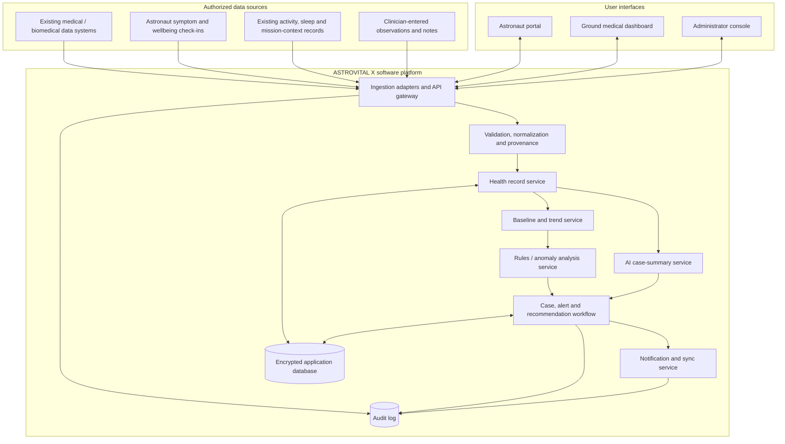
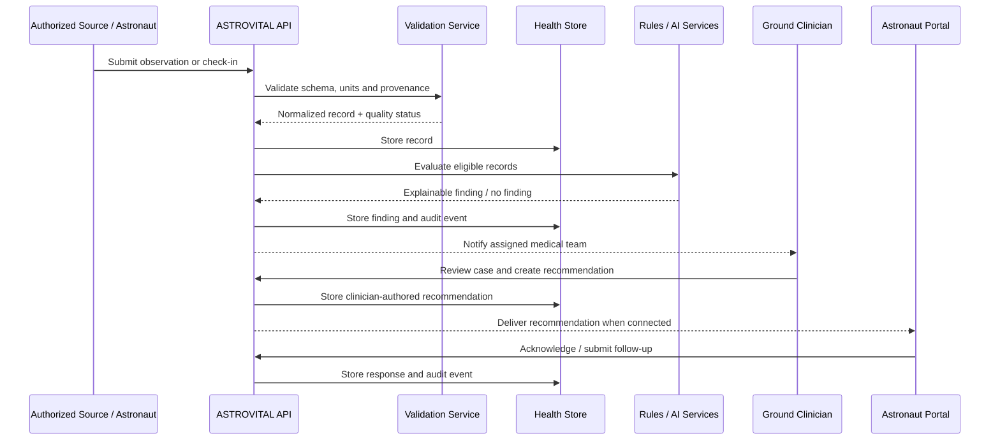
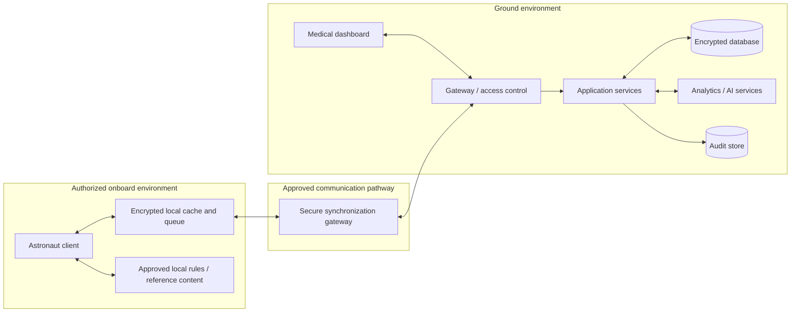

# 02 — System Architecture

**Version:** 1.0  
**Status:** Proposed logical architecture

## 1. Architecture principles

1. **Software-only scope:** ASTROVITAL X consumes available data; it does not create or control medical sensing hardware.
2. **Human clinical authority:** AI may summarize, classify data quality and flag patterns; clinicians make clinical decisions.
3. **Data provenance first:** Each observation carries source, unit, timestamp, collection context and quality metadata.
4. **Offline-aware:** The application distinguishes local, queued, synchronized, delivered and acknowledged states.
5. **Least privilege:** Astronauts see their own data; clinicians see assigned cases; specialists see referrals; administrators manage the platform.
6. **Modular integration:** External data sources connect through adapters instead of being embedded in business logic.
7. **Explainable alerts:** Every alert links to the records and rules that triggered it.
8. **Synthetic-first prototype:** All demo data is labelled synthetic. Operational integration is a future, authorized activity.

## 2. Logical system overview

## 3. Main components

### 3.1 Client applications

**Astronaut portal**
- Displays own health profile and available observations.
- Shows freshness and source labels.
- Captures symptom check-ins and wellbeing questionnaires.
- Displays clinician recommendations and requests for follow-up.
- Shows message delivery state and last successful synchronization.

**Ground medical dashboard**
- Lists assigned astronauts and open cases.
- Shows observations, trend plots, symptom reports and AI-generated summaries.
- Provides alert disposition, case assignment and recommendation workflows.
- Distinguishes AI-generated content from clinician-authored content.

**Administrator console**
- Manages demo accounts, role assignment and data-source configuration.
- Displays system health, ingestion errors and audit events.
- Does not provide clinical decision tools by default.

### 3.2 API gateway / backend

Responsibilities:
- Authenticate requests and resolve user identity.
- Enforce role-based access and astronaut assignment rules.
- Validate request schemas and units.
- Route requests to domain services.
- Apply rate limits and request-size limits.
- Create audit events for sensitive actions.

### 3.3 Data ingestion adapters

Each external data source should have its own adapter. An adapter maps the source-specific format into the normalized ASTROVITAL X observation schema.

Adapter requirements:
- Authenticate to the upstream system using an approved mechanism.
- Preserve upstream source identifier and record identifier.
- Preserve the original value and unit where appropriate.
- Convert to a canonical unit only when the conversion is known and tested.
- Record ingestion time separately from observation time.
- Reject or quarantine malformed records rather than silently correcting them.
- Support idempotent ingestion to avoid duplicate observations.

For the hackathon, implement a `synthetic-demo` adapter or seeded fixture loader. Do not create a fake NASA API integration.

### 3.4 Validation and normalization service

Checks:
- Required fields and types.
- Supported measurement type.
- Unit compatibility.
- Timestamp format and timezone handling.
- Plausibility bounds used only for data-quality screening, not diagnosis.
- Duplicate source records.
- Missing, stale or conflicting data.

Output: normalized observation plus a data-quality status such as `valid`, `missing_metadata`, `out_of_expected_range`, `stale`, `conflicting` or `rejected`.

### 3.5 Health record service

Stores astronaut profiles, observations, symptom check-ins, consultations, recommendations and follow-up responses. It provides authorized query and history endpoints.

### 3.6 Baseline and trend service

Creates personal reference summaries only when enough suitable observations exist. A baseline should include its date range, sample count, method, version and confidence/quality state. It must not silently treat population averages as an individual's normal value.

### 3.7 Rules and anomaly analysis service

MVP: transparent rules over seeded synthetic data.  
Next stage: validated statistical or machine-learning anomaly detection.

Every rule/model result should include:
- Result identifier and version.
- Relevant input observation identifiers.
- Trigger explanation.
- Time window.
- Missing-data and quality caveats.
- Severity or review priority, not a diagnosis.

### 3.8 AI case-summary service

Optional service that produces structured summaries from authorized records. It must not invent missing measurements, diagnoses, treatment plans or medical thresholds. Each factual statement should link to source record IDs. If the source evidence is insufficient, the output must say so.

### 3.9 Case and recommendation workflow

Manages:
- Case creation and assignment.
- Alert acknowledgement, disposition and escalation.
- Clinician review notes.
- Recommendations and follow-up requests.
- Astronaut acknowledgement and response.
- Case closure or continued monitoring.

### 3.10 Notification and synchronization service

Supports in-app alerts and queued messages. The system maintains distinct delivery states:

`draft → queued_local → submitted → delivered_to_service → viewed_by_recipient → acknowledged`

A local queue item must never be displayed as delivered before the server confirms receipt. A delivered message is not necessarily read or acted upon.

## 4. Data flow

## 5. Connected and communication-constrained modes

### Connected mode
- Synchronize new observations and check-ins.
- Notify assigned ground medical team.
- Support asynchronous consultation and, where mission systems permit, a separate approved voice/video service.
- Track sent, delivered, viewed and acknowledged states.

### Communication-constrained mode
- Keep local access to the latest synchronized profile and approved reference material.
- Allow permitted entries to be saved to an encrypted local queue.
- Run only approved local rules and non-diagnostic decision support.
- Display last synchronization time and clearly state that ground staff may not have received the new item.
- Do not promise live doctor response when the link is unavailable or delayed.

### Reconnection
- Retry queued records with idempotency keys.
- Resolve duplicate submissions safely.
- Preserve original event time and actual server receipt time.
- Surface conflicts for review rather than overwriting silently.

## 6. Recommended prototype technology layout

| Layer | Suggested implementation |
|---|---|
| Astronaut and doctor UI | React or Next.js |
| API | Python FastAPI |
| Authentication | Managed OIDC provider or secure demo auth; do not roll custom production auth |
| Database | PostgreSQL; SQLite acceptable for a very small local demo |
| Background jobs | Celery/RQ or a simple background worker for prototype |
| Realtime updates | WebSocket or Server-Sent Events |
| AI/analytics | Python, pandas, NumPy, scikit-learn |
| LLM summaries | Optional, constrained retrieval and source-linked output |
| Local/offline queue | IndexedDB in browser or encrypted local store in approved client |
| Deployment | Docker Compose for demo; production deployment requires security review |

## 7. Deployment view

This is a logical target model, not a claim that ASTROVITAL X is currently approved for spacecraft deployment. Real deployment would require the relevant mission architecture, cybersecurity, safety and medical approvals.

## 8. Security boundaries

- Astronaut client: user-scoped access to own records.
- Clinician client: case assignment and specialty-limited access.
- Admin console: account and configuration access; no implicit clinical authority.
- Integration adapter: narrowly scoped credentials for its approved upstream source.
- AI service: receives only the minimum records needed for a specific analysis.
- Audit store: append-oriented; ordinary users cannot modify audit history.

## 9. Scalability and future integrations

Potential future integrations should be implemented through versioned adapters and only after authorization. Candidate data categories include biomedical telemetry exports, medical record systems, mission activity logs, sleep records and astronaut self-assessments. Do not hard-code vendor or agency endpoints before an actual interface agreement exists.

## 10. Architecture decisions to preserve

- Store canonical units and original source unit/value where feasible.
- Separate observation time from ingestion time.
- Keep AI findings distinct from observations and clinician notes.
- Version rules and models.
- Make data quality visible to users.
- Store audit events for access and clinical workflow actions.
- Never equate alert severity with a diagnosis.
