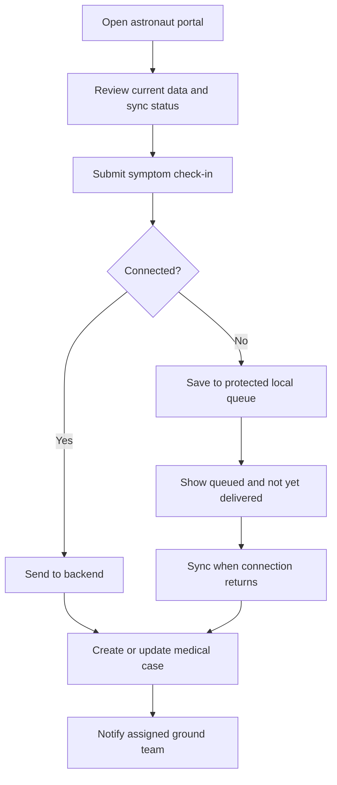
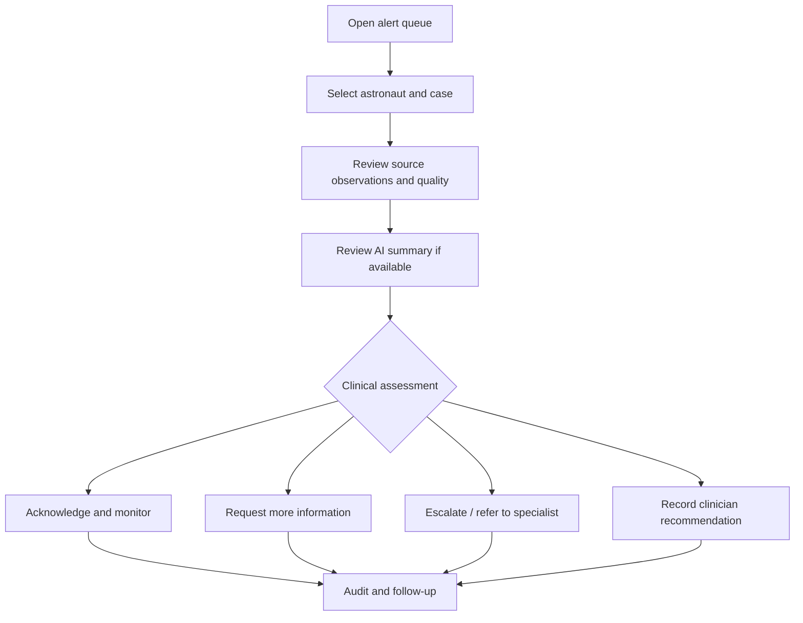

# 03 — Product Design and UX Specification

**Version:** 1.0  
**Status:** Proposed design baseline

## 1. Design objectives

The interface should make astronaut health information easy to review without implying more certainty than the data supports. The product has two main experiences—astronaut and ground medical expert—plus an administrative experience.

Design priorities:
- Clarity over visual complexity.
- Clear distinction between measured/imported data, self-reported data, synthetic demo data, AI-generated findings and clinician-authored decisions.
- Clear data freshness and synchronization state.
- Fast access to critical case context without hiding provenance.
- Accessible color contrast, keyboard navigation and text labels.
- Calm, professional medical operations aesthetic; avoid game-like or alarmist visuals.

## 2. Information architecture

```text
ASTROVITAL X
├── Astronaut Portal
│   ├── Overview
│   ├── My Health Timeline
│   ├── Symptom Check-in
│   ├── Medical Cases
│   ├── Doctor Recommendations
│   └── Sync / Messages
├── Medical Expert Dashboard
│   ├── Mission Overview
│   ├── Assigned Crew
│   ├── Alert Queue
│   ├── Astronaut Profile
│   ├── Health Timeline
│   ├── Case Review
│   ├── Specialist Referral
│   └── Recommendations / Follow-up
└── Administration
    ├── Users and Roles
    ├── Data Sources
    ├── System Status
    └── Audit Log
```

## 3. Role-based navigation

| Navigation item | Astronaut | Flight surgeon | Specialist | Admin |
|---|---:|---:|---:|---:|
| Own profile | Yes | If assigned/authorized | If referred/authorized | Support access only when authorized |
| Crew overview | No | Assigned crew | Referral scope | No clinical access by default |
| Submit symptoms | Yes | On behalf only if authorized | No, unless workflow requires | No |
| Alert queue | Own alert status | Assigned cases | Referred cases | Technical status only |
| Clinical recommendation | View/acknowledge | Create/revise | Create specialist opinion | No |
| User management | No | No | No | Yes |
| Audit log | Own relevant activity where policy permits | Clinical activity in permitted scope | Referral activity | Administrative/security events |

## 4. Screen specifications

### 4.1 Astronaut overview

**Purpose:** Give the astronaut a clear summary of available information and outstanding actions.

Elements:
- Welcome and mission/crew identifier (demo values only).
- Overall data status: current, partially current or stale.
- Last synchronization timestamp.
- Latest available health observations with units and timestamps.
- Open follow-up requests.
- Current medical recommendations.
- Symptom check-in action.
- Clear banner if data is synthetic or simulated.

Do not show a single green “healthy” badge based on incomplete data. Prefer “No open alerts in this view” or “Data incomplete—medical review may be needed.”

### 4.2 Astronaut symptom check-in

Fields:
- Symptom category (select multiple where appropriate).
- Onset date/time.
- Severity chosen by the astronaut using clear anchored labels.
- Whether symptoms are worsening, improving or unchanged.
- Optional free-text description.
- Optional structured wellbeing questions.
- Submit button and confirmation state.

The form must explain that submission does not guarantee immediate medical review, especially in communication-constrained mode. If an actual emergency exists, the astronaut must follow mission-approved emergency procedures; the software is not an emergency service.

### 4.3 Medical expert mission overview

Elements:
- Assigned astronaut roster.
- Open cases by review status.
- New and unacknowledged alerts.
- Data freshness and source connectivity indicators.
- Recently received check-ins.
- Queue filters: priority, astronaut, case status, time range.

Avoid ranking astronauts with a simplistic single “health score.” Use case-oriented signals and evidence.

### 4.4 Astronaut health profile

Sections:
- Profile and mission context.
- Current available observations.
- Historical trend charts.
- Symptom and wellbeing check-ins.
- Existing medical case history.
- Data sources and quality warnings.
- Personal baseline summary, if sufficient data exists.
- AI findings and clinician notes in separate panels.

Each chart should display the measure, unit, source, time window and missing-data gaps.

### 4.5 Alert detail and case review

Elements:
- Alert name and review priority.
- Clear statement: “This is a software-generated flag for review, not a diagnosis.”
- Trigger rule/model and version.
- Linked observation records.
- Data quality and freshness notes.
- Relevant baseline and time window.
- AI summary (if enabled) with source links.
- Clinician review notes.
- Actions: acknowledge, dismiss with reason, escalate, request more information, assign specialist.

### 4.6 Clinician recommendation composer

Fields:
- Recommendation category.
- Instruction text.
- Requested astronaut follow-up.
- Due/target time where appropriate.
- Priority.
- Optional approved reference/protocol link.
- Confirm authorship and submit.

The UI must make clear that the recommendation is authored by the logged-in clinician. No AI-generated treatment instructions should be sent without clinician review and explicit approval.

### 4.7 Consultation and messaging

Elements:
- Case-linked asynchronous message thread.
- Author, timestamp and delivery state.
- Attachments only if allowed by the security policy and configured limits.
- Separate link to an approved external voice/video service if available.

Do not implement an unverified promise of real-time telemedicine. Show when a message is queued, delivered, viewed or acknowledged.

### 4.8 Offline and synchronization status

Use persistent status indicators:
- **Connected:** server reachable; last sync time shown.
- **Syncing:** upload/download in progress.
- **Queued locally:** saved on device but not yet delivered to the ground service.
- **Partially synchronized:** some records remain pending.
- **Stale data:** no recent update from a source.
- **Conflict requires review:** duplicate or contradictory records detected.

Never use only color to indicate state. Add text and icons.

## 5. Visual design system

Suggested direction:
- Background: deep navy or neutral slate for a mission-operations feel.
- Primary accent: blue for navigation and information.
- Success: restrained green, used only for successful system states.
- Warning: amber for review-needed states.
- Critical: red for high-priority alerts, with text explanation.
- Cards: consistent spacing and clear grouping.
- Charts: accessible palettes and labels; do not rely on red/green alone.

Typography:
- Use a readable sans-serif typeface.
- Use large values only for a small number of key observations.
- Keep chart axis labels, timestamps and units legible.

## 6. Status vocabulary

| Status | Meaning |
|---|---|
| Normal data range | Observation falls within a configured display range; this does not guarantee absence of illness |
| Review suggested | A rule/model identified a pattern for clinical review |
| High-priority review | A configured workflow requires prompt review; not an autonomous diagnosis |
| Data incomplete | Required information is missing or insufficient |
| Stale | Source data is older than the configured freshness window |
| Synthetic | Demonstration-only generated data |
| AI-generated | Produced by an AI service; requires review where used clinically |
| Clinician-authored | Entered or approved by an identified medical professional |
| Queued locally | Saved on the client and not confirmed received by the server |
| Delivered | Received by the destination service; not necessarily read |
| Acknowledged | Recipient explicitly acknowledged receipt |

## 7. Key interaction flows

### Flow A: Astronaut submits concern



### Flow B: Clinician reviews alert



## 8. Accessibility and usability requirements

- All form fields have visible labels and validation messages.
- All essential workflows are keyboard-operable.
- Text and chart elements meet suitable contrast requirements.
- Status is conveyed through icon, label and color—not color alone.
- Important timestamps include timezone context or a clearly defined mission-time standard.
- Screen-reader labels describe charts and alert states.
- Do not use flashing or animated critical-alert effects as the only signal.
- Confirmation is required before irreversible actions.

## 9. Demo design guidance

For a hackathon demo, use two separate browser sessions or role switching:
1. Astronaut submits a synthetic symptom report.
2. Doctor dashboard receives a new case.
3. A demo alert is shown with its source observations.
4. Doctor writes a recommendation.
5. Astronaut sees and acknowledges the recommendation.
6. The audit timeline records the flow.

Keep a persistent “SIMULATED DATA — NOT FOR MEDICAL USE” banner on all demo screens.
