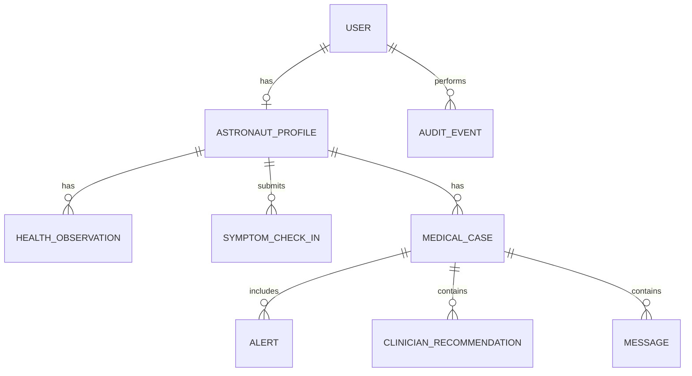

# 07 — Data Model and Synthetic Data Specification

**Version:** 1.0  
**Status:** Proposed logical data model

## 1. Data model principles

- Separate people, observations, cases, alerts, messages and recommendations.
- Keep imported observations distinct from self-reports and clinician notes.
- Preserve source provenance and timestamps.
- Track synthetic/real-data status at record level.
- Store canonical units only when conversion is known and tested; preserve source values.
- Do not overwrite clinical history silently; record amendments and audit events.

## 2. Core entities

### User

| Field | Type | Notes |
|---|---|---|
| id | UUID/string | Primary key |
| username | string | Unique login identifier |
| display_name | string | Demo-safe display name |
| role | enum | `astronaut`, `flight_surgeon`, `specialist`, `admin` |
| status | enum | `active`, `suspended`, `disabled` |
| created_at | timestamp | Account creation |

### AstronautProfile

| Field | Type | Notes |
|---|---|---|
| id | UUID/string | Profile key |
| user_id | UUID/string | Link to astronaut user |
| mission_alias | string | Use a demo alias; avoid real identifiers |
| mission_context | JSON | Optional mission metadata |
| assigned_clinician_ids | array | Authorization mapping; enforce on server |
| profile_status | enum | `active`, `inactive`, `archived` |

### HealthObservation

| Field | Type | Notes |
|---|---|---|
| id | UUID/string | Observation key |
| astronaut_id | UUID/string | Subject |
| data_type | string/enum | e.g. `heart_rate`, `spo2`, `blood_pressure`, `ecg_summary`, `sleep_duration`, `symptom_score` |
| value_numeric | number/null | Numeric value if applicable |
| value_text | string/null | Structured/text value if not numeric |
| unit | string/null | Required for numeric measurement where applicable |
| observed_at | timestamp | Time measurement/event occurred |
| received_at | timestamp | Time ASTROVITAL X received it |
| source_type | enum | `authorized_device_system`, `medical_record`, `astronaut_report`, `clinician_entry`, `synthetic_demo` |
| source_name | string | Human-readable source |
| source_record_id | string/null | Upstream identifier if available |
| collection_context | JSON | Activity, posture, protocol or other metadata if available |
| quality_status | enum | `valid`, `missing_metadata`, `stale`, `conflicting`, `out_of_expected_range`, `rejected` |
| quality_notes | string/null | Explanation |
| is_synthetic | boolean | Must be true for demo-generated records |
| original_value | string/null | Optional preserved source representation |
| original_unit | string/null | Original source unit |

### SymptomCheckIn

| Field | Type | Notes |
|---|---|---|
| id | UUID/string | Primary key |
| astronaut_id | UUID/string | Subject |
| submitted_by_user_id | UUID/string | Author |
| symptoms | array | Structured symptom categories |
| onset_at | timestamp/null | User-reported onset |
| severity_self_reported | integer/null | User-reported scale; define scale in UI |
| trend | enum | `improving`, `unchanged`, `worsening`, `unknown` |
| description | text/null | Free text, protected data |
| submitted_at | timestamp | Submission time |
| is_synthetic | boolean | Demo marker |

### MedicalCase

| Field | Type | Notes |
|---|---|---|
| id | UUID/string | Primary key |
| astronaut_id | UUID/string | Subject |
| created_from_checkin_id | UUID/string/null | Optional source check-in |
| assigned_clinician_id | UUID/string/null | Case owner |
| status | enum | `new`, `under_review`, `awaiting_astronaut`, `referred`, `monitoring`, `closed` |
| priority | enum | `routine`, `review`, `urgent_review` — not diagnosis severity |
| title | string | Neutral summary |
| created_at | timestamp | Creation time |
| updated_at | timestamp | Last update |

### Alert

| Field | Type | Notes |
|---|---|---|
| id | UUID/string | Primary key |
| case_id | UUID/string/null | Related case |
| astronaut_id | UUID/string | Subject |
| alert_type | string | Rule or model finding name |
| priority | enum | `informational`, `review`, `urgent_review` |
| status | enum | `new`, `acknowledged`, `dismissed`, `escalated`, `resolved` |
| explanation | text | Why alert was created |
| evidence_observation_ids | array | Source records |
| rule_or_model_id | string | Versioned detector identifier |
| created_at | timestamp | Alert time |
| disposition_by | UUID/string/null | Clinician/user who acted |
| disposition_reason | text/null | Required for dismissal where configured |
| is_demo_only | boolean | True for prototype-only rule |

### ClinicianRecommendation

| Field | Type | Notes |
|---|---|---|
| id | UUID/string | Primary key |
| case_id | UUID/string | Related case |
| author_user_id | UUID/string | Clinician author |
| recommendation_type | enum | `information_request`, `follow_up`, `consultation`, `approved_instruction`, `other` |
| content | text | Clinician-authored content |
| follow_up_due_at | timestamp/null | Optional |
| created_at | timestamp | Authorship timestamp |
| status | enum | `draft`, `sent`, `acknowledged`, `completed`, `superseded` |
| version | integer | Version number |

### Message

| Field | Type | Notes |
|---|---|---|
| id | UUID/string | Primary key |
| case_id | UUID/string | Related case |
| sender_user_id | UUID/string | Sender |
| recipient_user_id | UUID/string | Recipient |
| body | text | Message body |
| created_at | timestamp | Client/event time |
| server_received_at | timestamp/null | Server receipt time |
| delivery_status | enum | `draft`, `queued_local`, `submitted`, `delivered`, `viewed`, `acknowledged`, `failed` |
| idempotency_key | string | Retry protection |
| is_synthetic | boolean | Demo marker |

### AuditEvent

| Field | Type | Notes |
|---|---|---|
| id | UUID/string | Primary key |
| actor_user_id | UUID/string/null | User or service actor |
| action | string | e.g. `profile_viewed`, `alert_acknowledged`, `recommendation_sent` |
| object_type | string | Affected entity type |
| object_id | UUID/string | Affected entity ID |
| occurred_at | timestamp | Event time |
| outcome | enum | `success`, `denied`, `failure` |
| metadata | JSON | Non-sensitive technical context only |

## 3. Relationships



## 4. Data type/unit guidance

The exact canonical unit list must be confirmed during implementation and against upstream interface specifications. Example conventions for a prototype:

| Data type | Suggested canonical representation | Important note |
|---|---|---|
| Heart rate | beats/min | Preserve source context and method |
| SpO₂ | percent | Preserve source quality and timestamp |
| Blood pressure | mmHg, systolic/diastolic fields | Do not infer if not supplied |
| Temperature | °C or source unit plus conversion | Distinguish skin vs core where known |
| Sleep duration | minutes or hours | Identify source and time window |
| ECG | waveform reference or structured interpretation | A text summary is not raw ECG |
| Hydration-related indicator | named estimate with inputs | Never label as direct hydration measurement |
| Wellbeing check-in | structured answers | Self-reported, not a diagnosis |

## 5. Synthetic demo dataset

Use fictitious identifiers such as `ASTRO-DEMO-01` and names such as `Alex Demo`. Every synthetic observation should include `is_synthetic: true` and `source_type: synthetic_demo`.

Example observation:

```json
{
  "id": "obs_demo_001",
  "astronaut_id": "astro_demo_01",
  "data_type": "heart_rate",
  "value_numeric": 82,
  "value_text": null,
  "unit": "beats/min",
  "observed_at": "2026-11-14T08:30:00Z",
  "received_at": "2026-11-14T08:30:02Z",
  "source_type": "synthetic_demo",
  "source_name": "ASTROVITAL X demonstration fixture",
  "source_record_id": "fixture_hr_001",
  "collection_context": {"activity": "resting", "location": "demo habitat"},
  "quality_status": "valid",
  "quality_notes": "Synthetic demonstration value; not a clinical measurement.",
  "is_synthetic": true,
  "original_value": "82",
  "original_unit": "beats/min"
}
```

Example symptom check-in:

```json
{
  "id": "checkin_demo_001",
  "astronaut_id": "astro_demo_01",
  "submitted_by_user_id": "user_astronaut_demo",
  "symptoms": ["dizziness", "fatigue"],
  "onset_at": "2026-11-14T09:00:00Z",
  "severity_self_reported": 3,
  "trend": "unchanged",
  "description": "Synthetic demonstration scenario.",
  "submitted_at": "2026-11-14T09:15:00Z",
  "is_synthetic": true
}
```

## 6. Data retention and deletion

Retention periods must be defined by the responsible mission operator and applicable legal, privacy and medical-record requirements before real data is processed. The hackathon database should contain only synthetic data and may be reset between demos. Do not invent a production retention period in the prototype.
